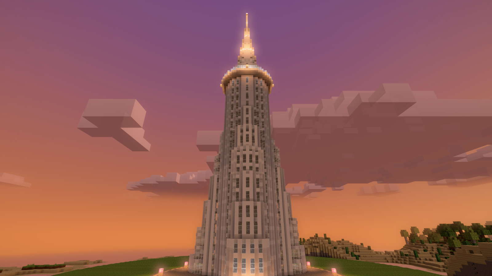
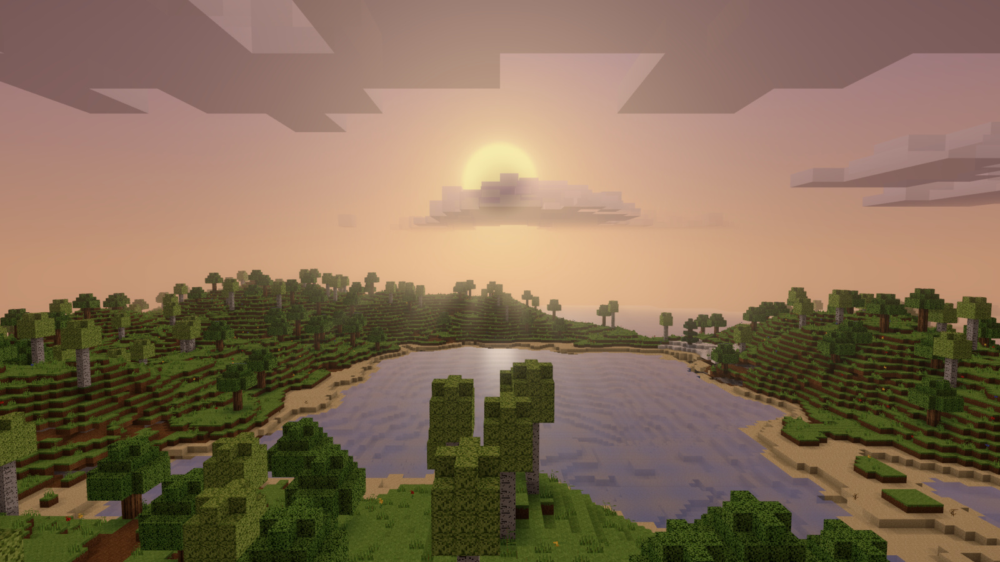
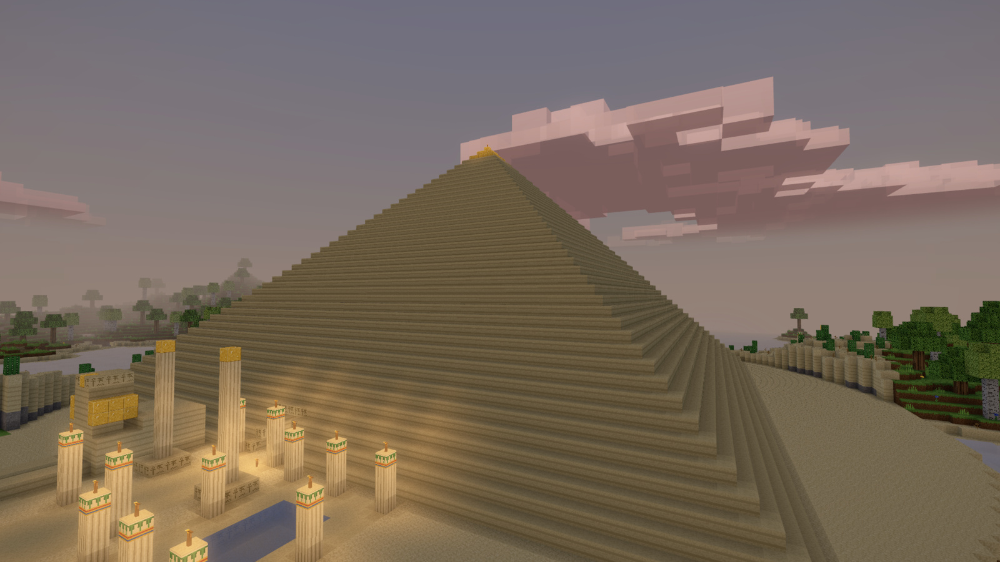
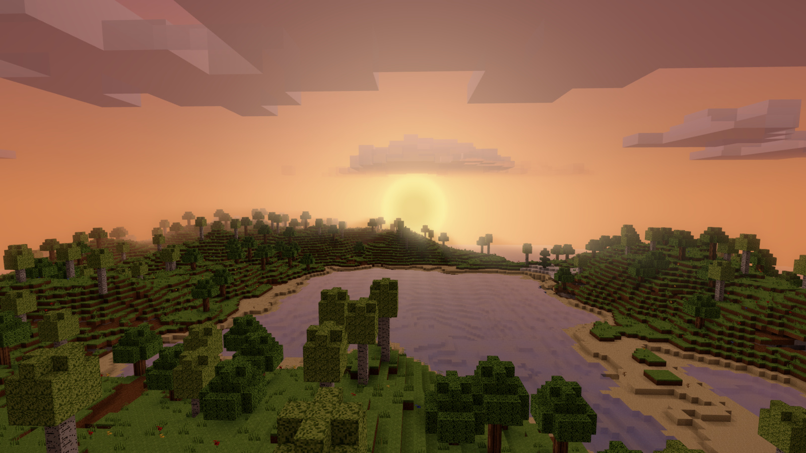

# Blockhaven

A first-person voxel game for macOS: RealityKit renderer, streaming chunked
terrain, inventory and crafting, survival and creative modes. Swift Package
Manager, no external dependencies.

## Screenshots

Every picture below is the game rendering itself. There is no external
screenshot in this repository and no picture that was touched after it was
taken: `Tools/gallery.sh` drives the binary's own snapshot harness at a fixed
camera for each shot, so the gallery is a build artefact rather than a folder
of pictures somebody once took. Change the terrain, the shader or a landmark,
re-run it, and the diff shows you what moved.



The Burj Khalifa at sundown, in the demo world. It is the one landmark
allowed to touch the roof of the world — every other building stops six
blocks short, because six blocks of sky over a spire is what keeps it from
reading as a thing that ran out of world. Its beacon sits on the highest
block a 192-block world can hold, and you can climb the spiral stair inside
it from the lobby door to the observation deck.



The ordinary generated world, for contrast — no demo, nothing built, just
what the seed produced. The fog, the haze on the far hills and the light on the water are
the custom Metal shader and the post-processing pass, which is what the live
game runs; the snapshot harness defaults to a flat unlit path, and a picture
taken on that path is a picture of something the game never draws.



The Great Pyramid, in the demo world `make demo` opens. It stands due east of
the plaza on its own desert apron, and the direction was found by probing the
seed for the driest, flattest ground within sight of the site rather than
chosen by taste — which is why it comes up against the dawn.



The same valley, later. Nothing here is painted on a skybox: the sun is a disc
the sky shader places, and the grade it puts on the terrain is re-applied as
the clock runs — the one thing an ordinary snapshot cannot check, which is
what `BLOCKHAVEN_SNAPSHOT_REGRADE` exists for.

### Taking your own

```
Tools/gallery.sh                    # all four, about ten seconds
Tools/gallery.sh sundown
```

It needs the display awake and ImageMagick on `PATH`. See **Visual
verification** below for the harness underneath it and every knob it takes —
the landmarks, the mobs, the UI screens and the underwater captures all have
recipes there, and the gallery is only the four of them worth opening the
README with.

Two runs of the same shot come out pixel-exact **except in the water**: the
swell in the block shader is driven by wall-clock scene time rather than by
the time of day, so every water pixel lands somewhere different every run.
Anything that moves outside the water in a re-run is a real change.

## Run

```
make run
```

or `swift build -c release && .build/release/Blockhaven`. It opens fullscreen;
`BLOCKHAVEN_WINDOWED=1` keeps it in a window, and `BLOCKHAVEN_WINDOW_SIZE=WxH`
sizes that window.

Release, and not as a matter of taste. `BLOCKHAVEN_BENCH_STREAM=600` at
render distance 10 puts chunk streaming at 0.68 ms a frame optimised and
**20.27 ms** unoptimised — and the mean is the flattering half of that. The
worst frame is 3.47 ms against **171.18 ms**, and 171 ms is seventeen
frames dropped in a row on a 10 ms budget, which is exactly the hitch you
feel walking into new terrain. The world is octaves of noise and small
vector maths, and every bit of that is a real function call until the
optimiser gets at it. The headless checks pay the same toll: the vegetation
check is 0.7 s optimised and 39 s not.

Those release figures are double what they were at 0.34 ms and 1.80 ms, and
the reason is the world going from 128 blocks tall to 192. Nearly all of it
lands in `gather` — the mesher copies a padded neighbourhood whose height is
the world's, and almost all of the added volume is empty sky above the
terrain. 0.68 ms is 4% of a 60 fps frame and the worst case still does not
drop one, so it was worth paying for a 120-block landmark; narrowing that
copy to the occupied span is the obvious way to get it back if streaming
ever needs the room.

`make build` is a debug build on purpose, because its job is to answer "does
it compile" in three seconds rather than twenty, and `make run-debug` is
there for when a breakpoint has to land on a line an optimised frame has
inlined away.

`make check` runs every headless check in turn and stops at the first
failure, with its saves pointed at a scratch directory so nothing it writes
can land near a real world. `make demo` opens the demo world.

Note that `BLOCKHAVEN_BENCH_STREAM`'s value is the frame count, not a flag —
`=1` measures a single frame, which is the first and most expensive one, and
reports it as the average.

You pick **Survival** or **Creative** on the start screen and give the world
a name; the mode is fixed for that world, the name is what it's called in
the menus. The screen leads with **Continue**, which opens the world you
played most recently by name, and once there are two or more worlds a
**Load another world** line under the cards (or `L`) opens the full list —
one row per world with its mode and when you last played it, walkable with
the arrow keys. There is deliberately no way to delete a world from the menus.
`BLOCKHAVEN_MODE=creative` (or `survival`) skips the picker and drops
straight into a world.

A fourth card opens the **demo world** — three landmarks, a railway and a
coaster — which resets every time it is started and is never saved.
`BLOCKHAVEN_DEMO=1` opens it directly, and it is the one world a test run can
enter without care, because it has no save file to land on top of by
construction.

Worlds live one JSON file each under
`~/Library/Application Support/Blockhaven/saves/`. The directory
listing is the catalogue — there is no index to get out of step with it —
and `BLOCKHAVEN_SAVE_DIR=<absolute path>` moves the whole directory
somewhere else, which is how a test run gets nowhere near a world someone
is playing — it must be absolute, and an empty or relative value stops the
game rather than quietly falling back to the real directory. A
`world.json` left by a build older than the catalogue is copied in once, at
launch, as "My World", and then left alone forever as a backup. That copy
is marked done by a `saves/.migrated` file only after it has landed, so a
run that fails partway through tries again next launch rather than
abandoning the world.

## Controls

- `WASD` — move, `Shift` — sprint, `Ctrl` — sneak, `Space` — jump
- Mouse — look (click the window first to capture the pointer)
- Left click — mine the targeted block (hold; hardness and tool tier decide
  how long, and in creative it's a flat 0.05 s)
- Right click — place the held block, open a crafting table or a chest,
  swing a door, sleep in a bed, feed a wolf, or get into (and back out of)
  a minecart
- `F` / middle click — pick up the block you are looking at: it comes to
  hand from the hotbar if you have one, and out of thin air in creative
- While riding a cart: `W` / `S` push it along the track, in whichever
  direction you are looking
- `1`–`9` / scroll wheel — select a hotbar slot
- `E` — inventory and 2×2 crafting grid (`Tab` does the same, always). In
  creative the same screen carries the block palette down its left side
- `R`, or the Book button — the recipe book, listing every recipe with
  what it costs and how much of that you have. Both it and the palette
  scroll with the wheel, the arrows, `Page Up`/`Page Down`, `Home`/`End`,
  or by dragging the scrollbar
- Double-tap `Space` — toggle flight (creative only)
- While flying: `Q` up, `E` down — alongside `Space` and `Shift`, which
  still work. `E` does two jobs, and which one it does is decided by
  whether you are in the air: on the ground it opens the inventory, in
  flight it drops. `Tab` carries the inventory either way, so nothing is
  unreachable mid-flight.
- `F3` — debug overlay, `Esc` — release the pointer / close a screen /
  open the pause screen, which resumes, sets mouse sensitivity, switches
  between fullscreen and a window, saves and returns to the main menu, or
  quits (if that save can't be written, the screen says so and keeps the
  world open rather than leaving it behind)

## Getting out

The game runs fullscreen by default, and fullscreen here is a borderless
window with the menu bar and the Dock hidden — which for a while meant the
only way out was ⌘Q, with nothing on screen saying so. There are now three,
and they are all visible:

- the start menu's **Quit** button, bottom-left, or `Q`
- the pause screen's **Quit** row, reached with `Esc` from play
- **Windowed** — the button beside Quit on the start menu, `W`, or the
  pause screen's **Screen** row — which puts the title bar, the red close
  button, the menu bar and the Dock back. The choice is remembered for the
  next launch.

`BLOCKHAVEN_WINDOWED=1` still pins a run to a window whatever is stored,
which is what keeps a smoke test off the whole display; a run pinned that
way refuses the toggle rather than storing a change it isn't honouring.

## Game modes

| | Survival | Creative |
|---|---|---|
| Health, hunger, drowning, fall damage | yes | no |
| Mining time | by hardness and tool | flat 0.05 s |
| Broken blocks | drop into your inventory | vanish |
| Placing a block | consumes it | unlimited |
| Starting items | a wooden sword and three wooden tools | nine blocks on the hotbar |
| Tools | wear out and break (59 uses in wood, 1561 in diamond) | never wear |
| Where blocks come from | mining and crafting | an unlimited palette beside the inventory |
| Throwing something away | no | the palette's bin |
| Flight | no | double-tap space |
| Fizzlers | spawn at night, in the dark | none |

The rules live in `Game/GameMode.swift` as named properties rather than as
`if creative` checks spread through the game loop, so adding a third mode
means filling in a column.

A fizzler has to *see* you before it lights its fuse, and it only appears
where no lamp reaches. Both of those used to be missing, and together they
were why houses got eaten: the fuse was lit on distance alone and distance
goes through walls, so standing inside with a fizzler on the other side of
the wall — or on the roof, where they spawned, a roof being the first solid
block under the sky — took the wall out. Now a wall is an answer and a
torch is a wall you can carry: `MobSight` runs a ray from the fizzler's eye
to the player's, stopped by anything solid (glass included), and the spawn
rule asks `lightLevel`, which is block light only, so an unlit field at
night is 0 and a torch-lit yard is not. Losing sight defuses a lit fizzler;
losing *distance* does not, so one that has seen you still hunts you round a
corner.

Survival's half of that is the cost: the kit it starts with is wood, all of
it, and it runs out. Every block broken spends one use of the tool in your
hand and every landed sword blow spends one of the sword's; a worn tool
carries a bar under its icon, warns once when five uses are left, and says
so when it goes. That is what makes the ladder — wood, stone, iron, diamond
— a thing you climb rather than a list of recipes. It is off in creative,
where the palette would turn a worn pickaxe into an errand.

Creative used to hand its blocks over by filling all thirty-six inventory
slots with them, one item per slot. That is why crafting did not work in
creative: a crafted stack needs a free slot to land in, and there was never
one. The palette is that supply moved out of the bag and onto its own
shelf — so the bag starts nearly empty, a chest will keep what you make,
and `BLOCKHAVEN_CHECK_CREATIVE=1` asserts both, along with every palette
cell being clickable and a chest's contents surviving a round trip to
disk.

## The storyline

A new survival world has a story in it: a light blinking on the Moon, a dead
radio in a survey station near spawn, three old machines to find — on top of
a spire, in a buried vault, in a wreck on the sea floor — then a launch pad,
a rocket, and a garden on the Moon to wake up. The design is
`specs/survival-storyline.md`; nothing of it touches creative or the demo
world, and you can ignore it and just play.

- **Home.** A glow crystal mends the radio. Each machine teaches one part of
  the rocket, and the objective line points at the nearest one left; with
  all three the expedition recipes unlock.
- **The trip.** Build the pad, stand the rocket on it, load two fuel cells
  (ice in a furnace), arm it, launch. One cell is kept for the way home. The
  inventory goes with you; the home world waits exactly as you left it.
- **The Moon.** Low gravity, no air, a black sky. A space suit holds six
  breaths' worth of air; a sealed, powered room with an air maker holds it
  for good.
  The garden has three faults — light, water, growth — fixed with wire,
  ice and torches, and seeds. Sentries come to inspect live wire.
- **The end.** Pull the lever, take the seeds home, plant them. The blink in
  the sky turns steady.

The pause screen keeps a journal of where you are. Harness knobs:
`BLOCKHAVEN_STORY_START=moon` starts a new world on the Moon,
`BLOCKHAVEN_SNAPSHOT_STORY=moon|home` frames a snapshot there, and
`BLOCKHAVEN_NO_STORY=1` turns it off.

## How it's built

The world (`Voxel/World.swift`) streams 16×16×128 chunks around the player.
Chunk *data* is a pure function of coordinate and seed, so it's generated on
a background queue and handed back through a lock-protected inbox that the
game loop drains once a frame — the chunk map itself is only ever mutated
from the loop's own thread. Tree placement rides along on that queue for the
same reason: deciding where a chunk's trees go costs a biome and a surface
height for all 256 columns plus a 7×7 local-maximum roll per candidate, and
it depends on nothing but the seed. Only the *writing* is left for the loop,
which has to happen there because a canopy can spill into a neighbour.

Chunk geometry is built on a background queue too (`blockhaven.mesh`), which
is what the split in `ChunkMesher` is for: the loop copies the chunk's
neighbourhood out of the world (208 KB, ~0.09 ms), a worker turns that copy
into vertices (~0.43 ms), and the loop uploads the result (~0.09 ms). Only the
first and last of those can touch RealityKit or the live block arrays.
Because a build can be in flight when the player breaks a block, every chunk
carries a `revision` that the builder records and the installer re-checks —
a result that describes a world which has moved on is dropped rather than
drawn over the fresh one. Blocks the player just changed skip the queue
entirely and are rebuilt on the frame they were changed, so a broken block
disappears on the click.

`Voxel/WorldGenerator.swift` layers value noise into continents, hills and a
masked mountain ridge, then carves caves from two intersected 3D noise
fields, seeds ore in depth bands (diamond below 16, coal to 88) and scatters
trees by biome density.

`Voxel/ChunkMesher.swift` emits a quad only where a block borders something
that doesn't occlude it, splitting output into an opaque, a translucent and
a *buried* `LowLevelMesh` per chunk. The third of those is the subject of
its own section below; most chunks never build it.

Before it touches a block it flattens the chunk and its eight horizontal
neighbours into one padded byte volume, because every lookup the mesher
makes — face culling, and the three occlusion samples per vertex — lands at
most one cell outside the chunk. Every one of those is then a single
integer index instead of a `World.block()` dictionary lookup. That is worth
about 9× on the whole mesh step: 3.9 ms per chunk before, 0.42 ms after,
measured over the 149 chunks of a radius-7 capture.

The volume is padded twelve cells rather than one, which the buried-face
classifier needs and nothing else does — see below for why twelve. Sky
exposure keeps a 18×130×18 volume of its own rather than riding along in
the wide one, because it reads one cell out and no further, and 208 KB a
chunk of which 42 KB is written is real memory traffic on a machine whose
other seven threads are generating terrain.

### Lighting, in the texture and in the vertices

`Rendering/TextureAtlas.swift` stores every face texture at eight
brightness steps, and the mesher picks the variant matching a quad's
*average* shade — three-sample voxel AO over the four corners, times a
per-direction tint. One unlit material then draws a whole chunk with baked
lighting and no shader at all.

On top of that each vertex carries a `uchar4Normalized` colour with three
numbers in it, all of which `blockSurface` reads:

- **red** — the ratio of this corner's occlusion to the face average the
  atlas already carries. That turns the flat per-face step into a smooth
  per-corner gradient: the soft darkening in an inside corner that a shader
  pack reads as contact shadow.
- **green** — sky exposure: 1 where the corner has open sky above it, 0
  under a canopy, an overhang or a ceiling. This is what puts a pool of
  shade under a tree.
- **blue** — 1 on water, 0 on everything else. Water and glass share one
  translucent material and the shader has to tell them apart; see the
  water section for why this is a vertex flag and not a texture-coordinate
  test any more.

Because the occlusion ratio of an evenly-lit face is exactly 1 and the
exposure of open ground is exactly 1, neither disturbs the atlas half: a
mesh drawn with the stock `UnlitMaterial` looks the way it did before the
colour channel existed (verified: 12 differing pixels in a 1600×1000
capture, all single-pixel edge dither from the AO triangulation flip;
byte-identical across the change that added the exposure channel; and
byte-identical again across the one that added the water flag, since the
fallback path writes an all-255 colour and never reaches the shader).

The colour channel is why chunks are `LowLevelMesh` and not
`MeshDescriptor`, which has no colour buffer to write into.

Exposure is measured with a sliding window rather than a march: one
downward sweep over the padded volume, carrying all 324 columns' running
totals at once, gives every cell the number of opaque blocks in the forty
above it for two byte loads and a store. Forty, not the whole column,
because everything past a canopy or an overhang is just a second way of
saying "underground", which the corner occlusion says already. Each corner
then averages four of those counts — the cell the face opens onto and the
same three neighbours ambient occlusion samples — so canopy edges land as
a gradient instead of a step.

The sample is taken **outside** the face, never in the block's own column,
and that distinction is the whole thing: a cliff face has ten blocks of
stone directly above the block it belongs to and nothing at all above the
air in front of it, and it is lit, not buried.

The sweep itself is nearly free (0.01 ms of a chunk); the per-corner taps
are not. Whole mesh build, when this was added: 0.41 ms a chunk before the
exposure channel, 0.49 ms after, measured over the 113 chunks of the
benchmark capture. That stage runs on the mesh queue, not on the frame, and
meshing still outruns generation by about eight to one, so chunks arrive no
slower. (Both halves of that measurement predate buried-face culling, which
skips three quarters of the faces and so pays the per-corner taps three
quarters less often; the current figure is 0.43 ms.)

Day/night is a single re-tint of those two shared materials, so the whole
world re-grades in one assignment.

#### Why there is no greedy meshing

Merging coplanar same-shade runs into bigger quads was measured, not
guessed: keyed on (atlas tile, atlas shade variant, four corner
occlusions), a greedy sweep over the spawn area turns 396,086 quads into
248,065 — a 38% cut, far short of the order of magnitude greedy meshing
gets on flat or underground terrain, because smooth AO fragments open
ground into per-corner-unique faces.

Buying that 38% would cost the atlas. A merged N×M quad needs its texture
to tile, and these tiles are packed in a sheet with a half-texel inset, so
tiling means moving atlas addressing into the shader (a second UV set
carrying the tile rect, plus `fract()`). The `UnlitMaterial` fallback
samples `uv0` raw and has no shader to do that in — so the game would need
two divergent geometry paths, and the default snapshot harness, which is
the tool that verifies atlas addressing, would stop testing the layout the
game actually ships. Against that: the game is vsync-bound at 100 Hz with
the meshing fast path in, so the vertices saved buy no frame that is
currently being missed.

### Most of the world is never drawn

At radius 7 — then the render distance, now 10 — the renderer used to hand
the GPU 1,737,216 vertices and
1,252,288 of them were cave walls — faces whose adjacent air cell has rock
over it, in a world with no block light, drawn every frame for nobody.
`ChunkMesher` now sorts every opaque face into a **surface** half and a
**buried** half, and a chunk builds only the surface half until something
asks to see inside it. The same capture is 484,928 vertices, a 72% cut, and
it is byte-identical to the one before the split.

A face is surface when the air it opens onto is **sky-open** — strictly
above the highest occluder in its own column — or is **connected** to
sky-open air through other non-occluding cells. Water does not occlude, so
a lakebed is surface, which is right: the water over it is see-through.
The whole translucent pass is left undivided, because the buried share of
it measured exactly zero vertices on both test captures and a pass that is
always whole can never be the reason a lake has a hole in it.

Two things about that rule are worth reading the code for, because the
obvious version of each is wrong.

**The connectivity search has no step limit.** The design this was built
from said "flood about eight steps out from daylight", which is the natural
shape — near a cave mouth you can see in a little way — and it fails. A
hillside seen nearly edge-on shows a viewer *tens* of blocks along a
one-block slot, so any fixed reach leaves a sliver of sky showing through
the far end of one. Raising the limit closed those slivers only
asymptotically: 8, 12 and 16 steps took one camera from 141 wrong pixels to
87 to 60, each step buying about 4% more geometry. That is the signature of
a criterion that is wrong rather than under-tuned. Removing the limit
altogether cost almost nothing — most cave air is a sealed pocket carved
out of intersected noise with no route to the surface at all — and made
every test camera exact.

**The padded neighbourhood is twelve cells, not one, and that is
correctness rather than margin.** A flood that runs off the side of its
volume answers a different question in every chunk, so geometry one chunk
calls visible its neighbour calls buried — which is a hole in a hillside,
and was one: 681 wrong pixels on the benchmark camera. Every chunk that can
classify a given cell has to search a box at least as big around it. Ten
and twelve are byte-identical to the old renderer and to each other, so
twelve is one step past where it converged.

Paying for that padding took two things back. `Chunk` caches its own
skyline — the highest occluder in each of its 256 columns, dropped on any
write and rebuilt on the next read — because scanning it out of a
208,000-cell volume on every build was most of the classifier's cost, and
the game loop wants the same fact anyway to know whether the player is
underground. And sky exposure moved into its own narrow volume, as above.

#### What reveals a chunk

Three things, and a revealed chunk stays revealed until it unloads:

- **an edit landing in it** — mining, placing, a fizzler crater, all of
  which go through `World.setBlock`;
- **the player's eye being under the ground**, which reveals a 5×5 square
  of chunks around them. That is 32 blocks of margin past the chunk they
  stand in, against a 160-block render distance, so a dead-straight tunnel
  longer than that would run out of geometry before it runs out of fog.
  Caves here do not go straight for 32 blocks. "Under the ground" is
  deliberately *not* the mesher's sky-open test, which counts leaves as
  occluders so a canopy costs no internal faces: a tenth of the walkable
  ground on this seed is not sky-open at eye height, and asking it that way
  turned one straight 281-block walk through the trees into 65 permanently
  revealed chunks. `World.hasTerrainOverhead` walks the column instead and
  ignores foliage, so a cave roof reveals and a tree does not;
- **the player holding the attack button on one of its blocks.** This one
  is a hedge rather than the mechanism, and it is worth being clear about
  which. What keeps a break from ever showing a hole is that `setBlock`
  reveals the chunk it writes to and marks it urgent, and `updatePlay` runs
  before `streamChunks` in the same tick — so the break frame rebuilds that
  chunk with *both* halves before anything is drawn. The pre-warm only
  matters when that rebuild does not land, the urgent pass already spending
  its budget of four on other edits, which in practice means a fizzler
  crater: once the break lands the chunk is dirty, and the buried-only path
  skips dirty chunks, so from then on the hidden half can only arrive with
  the full rebuild. Ordinary mining never gets near it —
  `BLOCKHAVEN_BENCH_MINE=5` measures 1.38 urgent rebuilds a break against a
  budget of four. Holding the button leaves the warm room to land anyway:
  five frames at 100 Hz against a build of about one that runs off the
  frame, and survival's seconds of mining are ample. It is gated on the
  button rather than on the raycast hitting something, because the
  crosshair rests on the ground for most of ordinary walking, and a reveal
  is permanent — firing on the bare hit handed the culling back a chunk at
  a time to a player who was only walking.

Revealing does not re-mesh the chunk. The two halves are separate meshes on
separate entities, so the buried one is built alone and hung beside the
surface geometry already on screen, which is never touched or re-uploaded.
A chunk that is already revealed and *then* edited rebuilds both halves
together.

Two consequences worth knowing. Loading a world replays the edit journal,
and a chunk with edits in it is one somebody has dug in — so those reveal
as they generate, or reloading would fill in the player's own tunnels until
they walked back into one.

And an edit reaches much further than the chunk it lands in. The classifier
floods a box that takes twelve cells of every neighbour, so a neighbour's
split can depend on any cell within twelve of the shared seam — which,
against a 16-wide chunk, is every column of every chunk. `World.setBlock`
therefore dirties the neighbours whose flooded box contains the edited
cell, which is **three at a chunk corner, five along an edge and all eight
over the middle 8×8** — of a chunk's 256 columns, a quarter get three, half
get five and a quarter get eight. Nothing recomputes a split except a
rebuild, so a neighbour that isn't told keeps a split computed against a
world that no longer exists until it unloads.

Those neighbours go on the background queue rather than the frame, and
there is no direction in which that is *safe* — no version of "the mesh
they are still showing is the more inclusive one". Breaking a block is
obviously not: the skyline drops, the flood gains seeds and reaches
further, faces move buried → surface, and a mesh missing those is a hole.
Placing one is not either, though it looks like it should be — the flood is
seeded with the cells between a column's own top occluder and the tallest
of its four neighbours', so raising this column's occluder *adds* seeds to
the four beside it and moves faces buried → surface exactly as a break
does. What makes the wait acceptable is that it is bounded, and only that:
dirty chunks are handed out nearest-first, an edit is by definition within
arm's reach, so these sit at the head of the queue and clear at two a
frame — four frames, inside the 0.05 s mining floor before the next block
goes — while the chunk actually being mined is rebuilt on the frame *and*
revealed. Making them all urgent instead would put up to eight main-thread
rebuilds, about 0.83 ms each, on the frame of every break.

#### What it costs and what it buys

Per chunk, over the 149 chunks of a radius-7 capture with the block shader
on, best of four runs on a machine at load 50:

| | before | surface only | both halves |
|---|---|---|---|
| gather (on the frame) | 0.02 ms | 0.09 ms | 0.09 ms |
| build (mesh queue) | 0.48 ms | 0.43 ms | 0.56 ms |
| upload (on the frame) | 0.13 ms | 0.09 ms | 0.18 ms |

So the build got cheaper — it skips three quarters of the faces and pays a
classifier for the privilege — and the frame's share is a wash: the wider
gather costs about what the smaller upload saves. `BLOCKHAVEN_BENCH_STREAM`
agrees on the build (1.19 to 1.16 ms a chunk) and puts the on-loop total at
0.100 ms a frame against 0.050, which is the gather without the upload
beside it. A live windowed walk is indistinguishable: 100 fps and a worst
frame of 11.0 ms either way.

That is the cost of *streaming*. The cost of the fan-out above is what a
player's own edits add on top, and `BLOCKHAVEN_BENCH_MINE=<frames between
breaks>` measures it: the same walk with the break button held down.
`=5` is a block every five frames, 20 a second — creative mode's flat floor,
and faster than anyone can mine while moving. Over 1500 frames at render
distance 10, three runs agreeing to the third digit, machine at load 65:

| | button up | held, 20 breaks/s |
|---|---|---|
| chunks meshed off the loop | 0.59 /frame | 1.45 /frame |
| urgent rebuilds on the loop | 0 | 0.28 /frame |
| on-loop total | 0.111 ms | 0.646 ms |
| dirty queue, mean / worst | 49 / 88 | 62 / 155 |

So 1.73 rebuilds a frame against a budget of two, and nothing starves: both
runs finish with the same 433 chunks loaded, and the dirty queue does not
grow with the length of the walk — it is bounded by how fast generation
populates a chunk's neighbours, not by the mesh budget. Three hundred breaks
cost 5.7 rebuilds each rather than the nine chunks they mark, because
`dirtyChunks` is a set and a player mining forward keeps re-marking the same
neighbours.

The real prize is not the millisecond, it is the room — and the next
section spends it.

### How far you can see

**Render distance is 10 chunks, 160 blocks.** It was 7, and the buried-face
split above is what paid for the change: at radius 10 the world is
3,659,148 vertices of geometry drawn as 975,340, so the GPU is handed *44%
fewer* vertices than it was at radius 7 before the split, while the horizon
sits 43% further away.

Every measurement below was taken on a machine at load average 60–80 with
sibling agents on it — the means are trustworthy, the worst-frame column is
mostly other people's processes, and it is called out where it matters.

| render distance | 7 | **10** | 12 |
|---|---|---|---|
| blocks | 112 | **160** | 192 |
| vertices drawn (benchmark camera) | 499,148 | **975,340** | 1,309,780 |
| …if nothing were culled | 1,767,372 | **3,659,148** | 5,036,812 |
| buried cut | 71.8% | **73.3%** | 74.0% |
| chunks drawn | 149 | **317** | 441 |
| on-loop streaming | 0.115 ms | **0.149 ms** | 0.191 ms |
| build, per chunk | 1.15 ms | **1.10 ms** | 1.10 ms |
| chunks in the data circle | 197 | **377** | 529 |

The per-chunk build cost is flat, which is the point: distance does not make
a chunk more expensive, it makes more chunks arrive per second. On-loop
streaming stays at 1.5% of a 10 ms frame.

**Why 10 and not 12.** Two captures, diffed pixel by pixel rather than
eyeballed. From the ground, going 10 → 12 changes 1.0% of the frame — the
fog at 160 blocks has already dissolved everything before the render edge,
so the extra ring mostly just thins the haze. From the air, where a kid in
creative actually spends the time, it changes 9.5%. Real, but half the
visual return per vertex that 7 → 10 gave (28.2% of the frame from the air,
14.1% from the ground). 10 is the knee.

The tiebreaker was that the one check that would have justified 12 could not
be made: a live windowed run at 3440×1440 reported 9 fps and a flat 116 ms
frame — and so did the *control* run at the old distance 7, because with no
user at the machine (`pmset -g assertions` shows `UserIsActive 0`) macOS
throttles an unfocused window to ~8.7 Hz no matter what it draws. Both
distances measured identically, which proves the render distance was not the
limiter but says nothing about whether 12 holds the vsync cap. Given a
number that could not be taken, 10 is the distance with the margin: 44%
under the geometry load this renderer was already shipping and playable at.

Startup priming is the one number that did move. Filling the data circle
took 2.0 s at radius 7, 4.0 s at radius 10 and past 4 s at 12 — but that is
contention, not work. The same run reports only **1.40 seconds of user CPU
across every thread** for the whole 4 seconds at radius 10, and the snapshot
harness, which generates and meshes the identical world *serially on one
thread*, goes from radius 7 to radius 12 for 0.61 extra CPU-seconds. Eight
background threads on an idle M2 Max are not the constraint; the other 70
processes were. Generation is also nearest-first, so the ground under the
player is there long before the horizon is.

`BLOCKHAVEN_RENDER_DISTANCE=<chunks>` overrides it, clamped to 2–14. The
ceiling is where the sky stops fitting: fog end *is* the render distance, and
it has to finish inside the cloud deck's fade (330 blocks) and the dome
(340), while the **corner** of the render square — √2 further out than the
radius — has to stay inside the camera's 400-block far plane. At 14 that
corner is at 317 blocks and the fog ends at 224. At 20 the fog would end on
top of the clouds and the corner would be sliced off in mid-air, so it is
refused rather than silently broken. Everything else follows the number on
its own: `dataDistance` is it plus one, the unload threshold is that plus
two, and `MaterialLibrary.setRenderDistance` moves the fog. The god-ray mask
and the post-processing chain do not move — they are sized off the frame,
which a capture at 3440×1440 confirms is identical at 7 and at 12 (same
860×360 bloom chain, same depth buffer, same god-ray sun uv and strength).

### Sky

`Rendering/SkyEntities.swift` draws the sky as nested camera-following
shells: a gradient dome at 340 blocks and the sun and moon on a 220-block
orbit. The dome is opaque and writes no depth, so terrain covers it and it
can never cover anything — which is the whole of the sky's draw ordering.
The clouds are not a shell; see below.

**Nothing in the sky writes depth.** The dome never did — it reads depth so
terrain covers it and writes none so it can never cover anything — and the
clouds, sun and moon were brought into line when the god-ray pass started
reading the depth buffer and found the cloud dome filling the whole sky with
distances between 70 and 260 blocks. They are all camera-following shells
that can never legitimately occlude anything, so the depth buffer this game
hands to a post pass now means exactly "terrain and mobs". The only visible
consequence is that a cloud behind the sun no longer gets cut out of the
layer by a hard 150-block square, which is a fix.

Its colours come from a small lookup texture (one column per compass
bearing, one row per elevation) holding a zenith-to-horizon ramp plus a
warm glow banked around the sun's bearing near the horizon. `SkyController`
keys both ends of that ramp through the day and repaints the lookup in
place a few times a second — never per frame, and never a mesh rebuild.
The sun, moon and cloud materials are built once and only re-tinted on
those slices (rebuilding them was 5–10 ms of main thread per slice), and
the slice the sky repaints on is deliberately half a step out of phase with
the one every chunk re-grades on, so the two bursts never share a frame.
The horizon end is also the fog colour, so distant terrain dissolves into
the skyline it meets: at dusk the fogged edge and the sky above it land
within a few 1/255ths of each other.

The sun and moon are small discs inside much larger tiles of radial glow,
so a low sun reads as light rather than a sticker (and gives a later bloom
pass something to grab).

#### Clouds

`Rendering/CloudLayer.swift` builds the deck from a procedural blob field
thresholded onto a grid of 8-block cells. It began as the original's own
"fancy clouds" — every covered cell extruded into one 3-block-thick box —
and the thing that took it past them is that a cell no longer carries a
slab. It carries a **stack**.

How many levels it stacks comes from how far its density cleared the
threshold, so the middle of a mass is seven levels tall (24 blocks) and its
rim is one, with a per-cell nudge on top so the tops are lumpy rather than
a smooth contour of the noise. Faces are emitted where a neighbour column
is *shorter*, which makes every step in the terrace a wall and leaves
everything below the skyline interior and undrawn. The base stays flat
while the top billows, which is not a simplification: cloud base is the
altitude where rising air hits its dew point, that altitude is the same for
every cloud in one air mass, and a real sky of cumulus has one ruler-flat
floor and a hundred different tops. 47k triangles, built once in 17 ms at
startup and never rebuilt — the layer moves by transform alone.

That geometry is most of the distance between plain clouds and the ones
in a shader pack, and no amount of shading closes it: a flat sheet lit
perfectly is still a flat sheet. What the shading then adds is depth *within*
a mass. The per-face brightnesses were widened from the classic 1.0 / 0.86 /
0.74 to **1.0 / 0.79 / 0.60** once there were terraces to put those faces
on, and each vertex carries how high up the stack it sits — in the `u`
channel, which this mesh has spare because it samples no texture at all —
so `cloudSurface` can darken the foot of a mass against its crown. No
per-face constant can do that: a wall two levels down in a crevice and the
wall on the sunlit crown above it are the same face direction. Vertical
rather than directional, because the light that reaches into the folds of a
cumulus is skylight and skylight comes from the whole dome.

Over that sits a continuous time-of-day tint — white by day, pink through
the golden hour, dim blue at night. Undersides take *all* of the golden
hour's warmth and tops about half, which is where the pink bellies come
from. The `cloudSurface` shader adds the two things a constant cannot: a
distance fade, and a kicker that brightens flanks facing a low sun
(weighted so it is exactly zero at noon).

The drift is the part worth reading the code for. The field is periodic in
384 blocks, and the layer's position is `drift + 384 · round((cameraX −
drift) / 384)`: the wind term modulo one tile, plus a re-centring snap to
the nearest whole tile. A whole tile is exactly one period of the blob
field, so the snap moves the geometry without moving a single cloud, and
the two terms stay continuous through the wrap. That is what replaced a
layer that slid up to 120 blocks off-centre and then yanked itself back
every 200 seconds. The re-centring costs a disc of geometry big enough that
the near rim is always at least 336 blocks away, and the shader's fade is
finished by 330 — inside both that rim and the camera's 400-block far
plane, which would otherwise slice the deck along a hard horizontal line.
(`BLOCKHAVEN_CLOUD_LOG=1` prints both numbers at startup, along with the
triangle count and the build time, so the relation stays checkable.)
Measured: stepping the camera across a re-centring boundary changes the
frame by mean 0.389/255, against 0.375/255 for an ordinary one-block step.

### Custom Metal shader (on by default)

`Shaders/BlockShaders.metal` is a RealityKit surface shader that adds
distance fog — terrain dissolves into the sky instead of ending at a hard
edge — swaps the mesher's fixed face tints for a moving sun, and turns
water into a mirror (both below). `Shaders/CloudShaders.metal` is a second
one, for the cloud deck. Both are gated on the same switch, so a frame is
never half custom-shaded. Build them with
`make shaders`, which needs Xcode's Metal toolchain — the Command Line
Tools don't ship `metal`, so that target points `DEVELOPER_DIR` at Xcode
explicitly while the Swift build keeps using whatever `xcode-select` has
active.

The haze starts at 0.64 of the render distance and piles up as the *cube*
of its progress from there, not the square. Both curves reach the horizon
colour at exactly the render limit, so the edge of the world still
dissolves into the skyline; the cube just leaves the middle distance
alone, where squaring had a ridge 80 blocks out already a seventh of the
way to white and the whole wide shot reading as milk.

It's on by default; `BLOCKHAVEN_CUSTOM_SHADER=0` opts out. Two cautions
learned the hard way: under the unlit lighting model the shader must write
`set_emissive_color` (a `set_base_color` write is silently discarded and
the world renders black), and `uv0` arrives v-mirrored relative to what
the mesh stores, so samples flip v. And a frame-rate log proves the
renderer is drawing, not that it draws the right pixels — compare against
the UnlitMaterial path when touching the shader. The snapshot harness
defaults to the unlit fallback, so it verifies geometry and textures;
`BLOCKHAVEN_SNAPSHOT_CUSTOM_SHADER=1` opts a capture into the real shader.

The compiled `default.metallib` is checked in so a plain `swift build` works
without the Metal toolchain installed. Every `.metal` file has to land in
that one library — a bundle has exactly one default library and RealityKit
will only link a surface shader out of the default one — so `make shaders`
compiles each source to `.air` separately and links them together. Note
that `make shaders` alone is not enough to *see* a change: the library is a
bundle resource, and only `swift build` copies it into the built bundle.

#### The sun moves, and the mesh does not

The mesher bakes a fixed per-direction tint into its choice of atlas
variant — top faces 1.0, the two horizontal axes 0.88 and 0.76, undersides
0.60 — which is how one unlit material can draw a lit-looking world with no
shader at all. The shader knows the normal, so it divides that constant
back out and puts `dot(normal, sunDirection)` where it was. Both paths keep
working off one mesh: `UnlitMaterial` still sees exactly the tint it always
did.

The trick that keeps this honest is that the term **cancels at noon**. What
a face gains from the sun is `kSunGain · max(0, N·L)` and what it gives
back is `kSunGain · max(0, N·up)` — the overhead sun the baked tint assumed
it was catching. With the sun at the zenith those are the same number on
every face and the whole thing is a no-op, so a noon capture matches the
one from before this existed to the byte outside the tree line. Everything
else is what happens as the sun leaves the zenith, which means the effect
peaks at golden hour by construction rather than by a hand-tuned weight.

Three smaller terms hang off that. A low sun puts the whole sky to work as
a lamp, so up-facing surfaces get some of their loss back (`kSkyLift`) —
without it a sunset landscape goes black rather than dim. Faces turned away
from a low sun lose a little more on top, which is what splits a hillside
into a lit side and a shaded one. And below the horizon the sun crossfades
into a faint cool moonlight on the opposite bearing over about four degrees
of sky, so dusk is a fade and not a switch.

Colour rides along with brightness: direct light warms toward orange as the
sun drops, ambient cools toward the violet of the sky it comes from, and
the pool of shade under a canopy is cooled as well as darkened, because
what reaches it is skylight.

#### Water is a mirror at grazing angles

Looking down into a lake still shows the bed; looking across one shows the
sky. That is a Fresnel ramp, steepened — Schlick's exponent is 5 and this
uses 2.4, so the mirror arrives earlier than physics would, which is the
difference between a lake and a puddle in a wide shot. The same ramp
thickens the water, because a reflection hides what is under it.

What it reflects is computed, not sampled. `skyAlong` is
`SkyEntities.gradientImage`'s rule written as arithmetic — the same
zenith-to-horizon ramp and the same warm glow banked around the sun's
bearing — evaluated along the reflected ray, because a reflected ray does
not land anywhere the sky dome's UVs can be asked about. On top of it goes
the sun's own reflection, measured as an angular offset from the sun and
weighted far more heavily across the sun's bearing than up and down it, so
a low sun scatters into a column running from the horizon toward the
viewer rather than a round highlight, which is the one thing that never
happens on open water. The swell tilts the mirror by a couple of degrees,
which swings what it reflects by four — that is what makes the streak
wobble — and the tilt fades out by 46 blocks, because near-grazing water
magnifies the slope enough to turn a sine field into corduroy at distance.
The old sparkle cells survive as a *modulation* of that streak rather than
light of their own: glitter on a reflection instead of confetti over a
lake.

The shoreline is not in it. Reflecting terrain needs a screen-space trace;
sky and sun carry the look without one.

Two things are worth knowing before touching this code. The normal the
shader is handed already faces the viewer — shading every back-facing
fragment red produced no red pixel anywhere, above the lake or under it —
so which side of the surface the camera is on has to come from the
geometry: view space is centred on the camera, so the eye sits at
`world + toEye * distance` and the sign of `toEye.y` answers it. That gate
is what keeps a submerged camera from seeing a ceiling of twinkling dots
with a sun in it. And `CustomMaterial` offers exactly four free float lanes
(`custom.value`), which is one short, so the sky's zenith colour rides in
one of them as three 8-bit channels. The lane is a real float32 — checked
by shading half a scene from an unpacked colour and the other half from
the same colour as a shader literal, which came out identical to the byte
— and every integer below 2^24 survives it exactly. The remaining lane is
a flag: 1 on the two-sided translucent material, 0 on the opaque one.

Water and glass share that translucent material, and telling them apart is
the one place this got bitten. The shader used to ask whether the
interpolated atlas `v` fell inside the water tile's row, and that drew a
dark hairline along every block seam across the whole lake. The cause is
MSAA: a pixel whose centre falls outside the triangle covering it is still
shaded, and its attributes are *extrapolated* past every value the
triangle's corners hold. Half a pixel of the `v` gradient is thousandths
of `v` in the middle distance and much more at range, so seam fragments
landed outside the row, failed the test, took the terrain path, and drew
dark and unreflected — 1,093 pixels of a 600×400 patch of open water drew
darker than their neighbours, the worst by 28 of 255. It is now a
per-vertex flag in the blue channel of the vertex colour, 1 at all four
corners of every water quad: a constant extrapolates to itself, whichever
way the pixel centre falls, and none of those pixels remain. The lesson
generalises — **never decide a branch from an interpolated attribute
compared against a narrow range**, because the value at a triangle's edge
is not bounded by the values at its corners.

The same two-sidedness is why the moving sun skips that pass entirely.
RealityKit hands a surface shader a normal already turned to face the
viewer, so on a two-sided pass the mesher's own face direction is gone,
and with it the tint baked into the atlas variant that the relight has to
divide back out. `bakedFaceTint` happens to be symmetric in x and z, so a
flipped side wall got away with it; a flipped horizontal one did not — the
underside of a glass pane seen from above was divided by 1.00 where 0.60
had been baked. There is no front-facing bit in `surface_parameters` to
recover the true normal with, so glass keeps the flat baked tint, which is
exactly what the `UnlitMaterial` fallback shows it as.

### Post-processing

`Rendering/PostProcessing.swift` hangs a compute pass off
`ARView.renderCallbacks.postProcess`: a quarter-size bright pass, an
`MPSImageGaussianBlur`, an eighth-size pair of god-ray dispatches, then a
composite that adds the glow and the shafts back, rolls highlights over a
shoulder and drops a whisper of vignette into the corners.
`BLOCKHAVEN_POSTFX=0` opts out.

The one surprise is worth writing down, because every threshold in the
file depends on it: the frame RealityKit hands over is already an 8-bit
`bgra8Unorm_srgb` texture, and nothing in this game ever renders past
about 0.69 in linear intensity. There is no HDR headroom to isolate
highlights with, and a golden-hour horizon (0.60) is *dimmer* than a
midday blue sky (0.66) — so brightness alone cannot bloom the sunset and
spare noon. Hue can, and does: the bright pass weights warm light far
harder than cool, which is not physics but is exactly the look being
chased. Lit grass (about 0.25) is far below the line either way and never
blooms at all.

#### Crepuscular rays

Late in the day the sun throws visible shafts through the tree line. They
are the same screen-space trick every shader pack uses — build a mask of
where the sun's light comes from, then blur it radially toward the sun's
screen position with about forty taps, and terrain in the way carves the
shadows out for free — with one thing done differently, forced by the same
8-bit ceiling every threshold in this file is built around.

The textbook mask is *bright sky near the sun*. Measured off a golden-hour
frame here: the sun's glow peaks at 0.638 in linear intensity, the sky a
hundred pixels beside it is 0.58, and open sky across the frame is 0.47.
The light source is ten percent brighter than its background. A game with
real HDR has a sun fifty times brighter than the sky, which is exactly why
an occluder crossing it removes nearly all the light and the beams read;
ten percent of ten percent produces a milky wash, and thresholding into the
0.06 of range that is left produces nothing at all.

So the mask is not brightness. It is **visibility**: 1 where the sky is
open, 0 where terrain is in the way, times a Gaussian around the sun. That
is the one quantity in the frame with real contrast in it — a leaf is not
10% darker than the sky behind it, it is *absent* — and it is also, of the
two, the one crepuscular rays physically measure. The colour comes from a
fixed warm tint and the strength from where the sun is, both known exactly
rather than inferred from pixels.

Reading "is this pixel sky" needs the depth buffer, and two things about it
had to be measured rather than assumed. It is **reversed-Z**: 1 at the near
plane, 0 at the far one, so bigger means nearer and nothing-drawn-at-all is
exactly 0. And the sky was writing into it — see the note under Sky above,
which is why the clouds, the sun and the moon no longer do.

Strength is `smoothstep`-gated on the sun being above the horizon and falls
to *exactly* zero with the sun overhead, so noon is untouched to the byte
and the two dispatches are skipped entirely rather than multiplied by a
small number. The same is true at night: no moon rays, on the grounds that
a moon dim enough to need them is dim enough not to have them. Off the side
of the screen the fan fades out over a screen width instead of switching
off, so turning away from a sunset doesn't pop. There is a soft hole in the
add over the sun's own disc, because bloom already owns that pixel and two
glows stacked on one spot is a flat white blob.

The whole thing runs at an eighth size on each axis — a shaft of light is
the lowest-frequency thing in the frame and the march is priced per pixel —
so at 3440×1440 it is 430×180 threads times forty taps.

#### What it costs

Measured on an M2 Max at 1280×800: 0.050 ms of GPU time a frame with the
effect on against 0.016 ms for `BLOCKHAVEN_POSTFX=copy`, which installs the
same callback and only copies. At the real display's 3440×1440, with the
benchmark camera pointed at a low sun so the rays actually run: **0.223 ms
for the whole pass, 0.143 ms with `rays=0`, 0.062 ms for copy** — so bloom
and tonemap are 0.081 ms and the god rays 0.080 ms, against a budget of
1.5 ms. (Taken with the machine under a load average of 122 from other work;
GPU time is much less sensitive to that than CPU time, but it is not zero.)
Frame rate is unchanged at the 100 Hz display's cap.
`BLOCKHAVEN_POSTFX_TIME=1` prints those numbers,
`BLOCKHAVEN_POSTFX_TUNE="intensity=0.4,warmth=1"` re-tunes without a
rebuild, and `BLOCKHAVEN_POSTFX_DUMP=/path.png` writes one processed frame
straight out of the callback (`BLOCKHAVEN_POSTFX_DUMP_SOURCE=1` writes the
same frame from before the pass, for differencing, and
`BLOCKHAVEN_POSTFX_DUMP_DEPTH=1` writes the *depth* buffer, log-encoded —
through an sRGB ramp a reversed-Z buffer quantises to solid black past a
few blocks, which is exactly the range that matters). A dump only has a
callback to come out of when the pass is installed, so under the snapshot
harness it needs `BLOCKHAVEN_SNAPSHOT_CUSTOM_SHADER=1` and not
`BLOCKHAVEN_POSTFX=0`; ask for one without those and the harness says so and
takes an ordinary capture rather than waiting for a dump that can't fire.

Timing the pass at the real display resolution takes a little arranging,
because the sun orbits the world's X–Y plane and the live game starts the
player facing +Z — a live run measures the god-ray pass in exactly the
state where it skips itself. So `BLOCKHAVEN_POSTFX_TIME=1` also tells the
snapshot harness to render for several seconds before it captures rather
than the usual twelve frames, since the timing line only reports once a
second; point it at the benchmark camera with
`BLOCKHAVEN_SNAPSHOT_SIZE=3440x1440` and read the numbers off stderr.
(`BLOCKHAVEN_WINDOW_SIZE=WxH` sizes the *live* window, which is the other
half of the same problem — the alternative was a borderless fullscreen run,
which is not something to leave lying around in a script.)

### Other pieces

Block picking is a 3D DDA raycast (`Voxel/VoxelRaycast.swift`). Movement
(`Player/PlayerController.swift`) resolves per-axis against the voxel grid
with a binary search back to the last non-colliding position, plus a sneak
edge guard that rolls back any step leaving you unsupported.

All UI — HUD, inventory, crafting, start menu — is Core Graphics drawn into
plain `NSView`s layered over the `ARView`, and every texture and item icon
is drawn procedurally rather than bundled as an image asset.

```
Sources/Blockhaven/
  App/        AppDelegate (menus ↔ game), GameViewController,
              OffscreenSnapshot, StreamBenchmark, MenuScript,
              ShapedBlockCheck, HouseBlockCheck, AxolotlCheck,
              AnimalCheck, VegetationCheck, RecipeBookCheck, ShowcaseHouse
  Engine/     GameView (input capture), InputState, FrameProfiler
  Game/       GameMode
  Math/       Vector3, seeded RNG / value noise
  Voxel/      BlockType, Chunk (blocks + cached skyline), World,
              WorldGenerator, ChunkMesher (mesh + buried-face classifier),
              ShapedBlocks (stair/door/pane/bed geometry),
              ShapedPlacement (placing, opening, breaking them),
              VoxelRaycast
  Items/      ItemType, Inventory
  Mobs/       Fizzler (AI + physics), FizzlerManager (spawning, explosions),
              Animal, AnimalManager, MobRaycast
  Crafting/   Recipe, RecipeBook, RecipeAutoFill
  Player/     PlayerController (physics), PlayerStats (health/hunger/air)
  Camera/     FirstPersonCamera
  Persistence/ WorldSave (chunk edits, player state, clock, name, bed spawn),
              WorldCatalog (the saves/ directory, migration, naming)
  Rendering/  TextureAtlas, MaterialLibrary, SkyController, SkyEntities,
              CloudLayer, PostProcessing, BlockHighlight, FizzlerEntity,
              FizzlerSkin, AnimalEntity, AnimalSkin
  UI/         HUDView, InventoryView, RecipeBookPanel, StartMenuView,
              NewWorldNameView, WorldListView, PauseMenuView, ItemIcons
  Settings/   GameSettings, Localization
Shaders/      BlockShaders.metal, CloudShaders.metal, PostProcess.metal
```

## Visual verification

There's no way to screenshot the running app without macOS Screen Recording
permission, so the binary can capture itself:

```
BLOCKHAVEN_SNAPSHOT=/tmp/shot.png BLOCKHAVEN_SNAPSHOT_UI=hud .build/release/Blockhaven
```

`Tools/gallery.sh` is this harness with the **Screenshots** gallery's cameras
written down, and it is the shortest way to see what a change did to the
picture: it rebuilds all four shots in about ten seconds, so a shader
or a terrain change shows up as an image diff rather than as a claim.

`_UI` takes `hud`, `inventory`, `table`, `creative` (the palette beside a
creative world's inventory, which is how a newly added item's icon gets
looked at — `_HOVER=<n>` puts the cursor on cell n and `_SCROLL=<points>`
scrolls it), `creativebook` (the palette and the recipe book open at once,
which is the layout that has to fit three panels across a window),
`chest` (a chest screen with something in it),
`book` / `book2x2` (the recipe book open over the 3×3 and the 2×2 crafting
screen — the second is the one that shows rows greyed out, with
`_HOVER=<n>` putting the cursor on row n so its hover note is drawn and
`_SCROLL=<points>` scrolling the list) or
`pause` to composite over the
render, or `menu`, `worlds` or `naming` to shoot a menu screen instead of
one (those need no world and return in milliseconds; point
`BLOCKHAVEN_SAVE_DIR` at a directory of worlds and they draw the real rows,
with `_HOVER=<n>` lighting a card or row and `_NAME=<text>` filling the
name field, and `_WARNING=1` showing the pause screen as it looks when a
save has just failed). `_ATLAS=1` dumps the
texture sheet instead; `_FIZZLERS=1` stands a row of fizzlers at increasing
fuse stages in front of the camera, plus every land animal strung out along
one clear bearing to the left — built from `allCases`, so a kind added later
cannot be quietly missing from the one shot whose job is to answer "are the
mobs rendering"; `_DEMO=1` captures the demo world instead of the default one — its own seed,
its landmarks and its railway, which exist nowhere else, so this is the only
way to photograph them; every capture also reports `brightest lamp N/255`
and whether smooth shading was on, which is how a dark render is told apart
from a render whose lamps never reached the geometry;
`_YAW`, `_PITCH`, `_TIME`, `_POS` and `_RADIUS` place the camera;
`_SIZE=WxH` sets the capture size (default `1600x1000`, minimum `320x200` —
anything smaller or unparseable falls back to the default). It builds a
world in an off-screen window, waits for RealityKit to actually draw, and
writes a PNG.

`_ANIMAL=<kind>` — any of `pig`, `cow`, `sheep`, `chicken`, `axolotl`,
`cod`, `squid`, taken from `AnimalKind.allCases` rather than a hand-written
list, so a kind added later is photographable the moment it exists — puts
one animal right on the camera's line of sight, close enough to fill the
frame. The lineup answers "are the mobs rendering"; this answers "is that
the right shape", which is the only way to tell a new model from a recolour
of an old one. `_ANIMAL_COUNT=<n>` places up to twelve in a loose spiral,
which is the only way to photograph a shoal at all — the thing worth looking
at about a cod is what six of them do, and one cod on its own is a picture
of the bug. `_ANIMAL_POSE` is `swim` (hovering, tail swung over) or `land`
(standing on the ground mid-stride), defaulting to whichever the kind
actually holds; `_ANIMAL_DIST` is blocks from the eye,
`_ANIMAL_TURN` degrees off face-on (40 by default, the three-quarter view
that gets a face and a profile into one picture), `_ANIMAL_DROP` blocks
below the sight line, which is how a swimmer is sunk under the surface of a
pond without solving for the pitch that would have put it there, and
`_ANIMAL_RARE=1` the rare colour where the kind has one:

```
BLOCKHAVEN_SNAPSHOT=/tmp/axolotl.png BLOCKHAVEN_SNAPSHOT_ANIMAL=axolotl \
  BLOCKHAVEN_SNAPSHOT_ANIMAL_DIST=1.3 BLOCKHAVEN_SNAPSHOT_YAW=180 \
  BLOCKHAVEN_SNAPSHOT_PITCH=2 .build/release/Blockhaven
```

A land pose is framed by `_DIST` and `_PITCH` together: the subject is
dropped to the ground under the sight line, so a shallow pitch at close
range puts it under the bottom of the frame. Around `_DIST=2.2
_PITCH=-38` is the shot. "Ground" skips leaves and trunks on the way down
— the spawn camera stands under a tree, and a drop that stopped at the
first solid thing would leave the subject standing on the canopy, above
the frame, in a picture that looks exactly like a mob that failed to
render.

How much world a capture builds — and where the fog ends, which is pinned
to the same number — is `_RADIUS` when it is set to a number, otherwise
`BLOCKHAVEN_RENDER_DISTANCE` when *that* parses as one, otherwise 4. Both
are parsed rather than merely tested for, because `World` falls back to the
shipping distance of 10 when its variable is garbage, and a snapshot that
quietly built 317 chunks where 49 were asked for is a picture that cannot
be compared with any other in the battery. Four is the cheap capture —
49 chunks and 125k vertices against 317 and 987k, 1.7 s against 2.2 s at
3200×2000 on a machine at load 99 — and it is deliberately not what the
game ships at: a plain snapshot is a 64-block world with fog ending at 64,
and the benchmark-camera recipe below (`_RADIUS=6`) a 96-block one.
Anything being judged against the real
horizon — fog falloff, haze over distance, vertex counts to compare with
the numbers above — has to ask for the shipped distance:
`BLOCKHAVEN_RENDER_DISTANCE=10` puts the same 317 chunks on screen the game
does.

A capture builds the **surface half** of every chunk and nothing else,
exactly like the live game does for a chunk nobody has revealed, which is
what makes this harness the acceptance test for buried-face culling: a
camera standing in the open has to produce the pixels it produced before
the split existed, or the classifier is hiding something visible.
`BLOCKHAVEN_SNAPSHOT_REVEAL=1` builds both halves. An underground capture
needs it — without it a shot from inside a cave is a picture of the sky,
because every wall around it is geometry the live game would only have
built on being asked. The `[snapshot] meshed …` line says which mode it
ran in and how many vertices the buried half held.

Snapshots render with plain `UnlitMaterial` by default — no fog, no water
swell — even when the live app is running the custom block shader. Add
`BLOCKHAVEN_SNAPSHOT_CUSTOM_SHADER=1` to render a snapshot through the real
shader instead, which also switches the post-processing pass on, for
checking fog falloff, water, bloom and daylight grading:

```
BLOCKHAVEN_SNAPSHOT=/tmp/shot.png BLOCKHAVEN_SNAPSHOT_CUSTOM_SHADER=1 \
  BLOCKHAVEN_SNAPSHOT_TIME=0.5 BLOCKHAVEN_SNAPSHOT_YAW=35 BLOCKHAVEN_SNAPSHOT_PITCH=-12 \
  .build/release/Blockhaven
```

`BLOCKHAVEN_SNAPSHOT_REGRADE=<t>` jumps the clock *after* the world is meshed
and re-applies the grade — the one thing an ordinary snapshot cannot check,
since the live game meshes a chunk once and then re-grades it for hours of
game time. Shoot the same view twice, `_TIME=t` against `_TIME=x
_REGRADE=t`, and the two should come out byte-identical.

Two captures of the same scene are otherwise pixel-exact — **except water**.
The swell in the block shader is driven by wall-clock scene time, not by the
time of day, so every water pixel lands somewhere different on every run.
Diff a `_CUSTOM_SHADER=1` capture and expect the lake to differ; everything
that isn't water still compares byte for byte.

Snapshots need the display awake. RealityKit has no offscreen renderer, so
the harness drives a real window and waits for real frames — and when the
screen has gone to sleep every window is occluded, nothing is scheduled,
and the run gives up with `only 0 frames rendered`. That is the machine
saying no, not a bug in the game; `caffeinate -du -t 600 &` first and it
captures normally, locked screen or not.

## Measuring performance

The display here runs at 100 Hz and RealityKit waits for it, so **the frame
rate is pinned at the cap whether a frame used 2 ms of CPU or 9**, and a
one-second mean hides a stutter completely: one 30 ms hitch among sixty
10 ms frames moves the average by three. Two tools exist because of that.

`BLOCKHAVEN_FRAME_LOG=1` reports, once a second, the worst single frame in
that second and where the CPU went, in milliseconds per second of wall
clock — `stream`, `gather`, `mesh`, `upload`, `mobs`, `sky`, `hud`. Both
numbers are taken from the *unclamped* frame delta; simulation still gets a
50 ms cap so a long frame can't push the player through a wall, but the
instrument does not, or `worst` would read exactly 50.0 ms during every
stall it exists to catch and `fps` could never fall below 20:

```
BLOCKHAVEN_NO_SAVE=1 BLOCKHAVEN_WINDOWED=1 BLOCKHAVEN_MODE=creative \
  BLOCKHAVEN_FRAME_LOG=1 .build/release/Blockhaven
```

Add `BLOCKHAVEN_BENCH_WALK=1` to fly the player forward on a slow curve.
Standing still is the one thing that does *not* exercise streaming: after
the spawn flood nothing generates, meshes or unloads, so a frame log taken
at rest measures an idle renderer.

`BLOCKHAVEN_BENCH_STREAM=<frames>` runs the streaming half of the frame loop
with no window, no RealityKit and no display at all, and reports **ms per
frame** per phase. It finishes with five self-checks that no frame log or
snapshot can reach without a mouse: that an edit rebuilds the chunk on the
frame it happened, that a block placed over the ground darkens the ground
under it, that the buried/surface split hides what it should and an edit
reveals the chunk it lands in, that an edit dead in the middle of a chunk
and *under* its skyline — digging into a hillside, both breaking and
putting back — still dirties all eight neighbours (the classifier reaches
twelve cells past the seam, and a neighbour that isn't told stays wrong
until it unloads; under the skyline is the case the rule this replaced
dropped, and a check that broke the top of a column instead would pass on
the bug), and that a standing spot under a tree reads as sky-blocked to the
mesher and as *open* to the underground trigger, while four blocks down
reads blocked to both. That number is independent of the refresh rate, and
it is measurable with the screen locked:

```
BLOCKHAVEN_NO_SAVE=1 BLOCKHAVEN_BENCH_STREAM=900 .build/release/Blockhaven
```

`BLOCKHAVEN_BENCH_MINE=<frames between breaks>` holds the break button down
for the whole walk, so the report also covers what a player's own edits cost
streaming: the chunk rebuilt on the loop, the classifier fan-out queued
behind it, and how deep the dirty queue gets. `=5` is creative mode's floor
of 20 breaks a second. Compare it against a plain run of the same length —
see *What it costs and what it buys*.

The report's first line names the render distance it ran at, because every
number under it moves with the distance and two reports that don't say
which one they used cannot be compared. `BLOCKHAVEN_RENDER_DISTANCE=<chunks>`
(2–14, default 10) is how you take the other one — see *How far you can see*
for the curve it traces.

Streaming currently costs the loop about **0.15 ms a frame, worst frame
0.5–3.6 ms** at the default distance of 10, against 0.30 ms and 8.7–11.2 ms
before geometry moved off-thread. It was 0.05 ms until buried-face culling
widened the neighbourhood copy; that copy is most of the difference, and the
benchmark does not see the upload it pays for (0.13 ms a chunk down to
0.09). The rest is the distance: the same build at radius 7 reports 0.115 ms
a frame, and per *chunk* the build cost is flat at 1.10 ms — distance does
not make a chunk dearer, it makes more of them arrive per second. The last
run over 900 frames reported 0.149 ms a frame and a worst
frame of 3.58 ms, on a machine at a load average of 57. Quote the load beside the number: the
mean barely moves, but the worst frame is where preemption shows up, so a
tail measured on a busy machine is the machine as much as the game. Most of
the mean came from moving geometry off-thread; most of the *tail* came from
one line, `generationQueue`'s QoS. It was `.userInitiated`, and being
concurrent it put eight high-priority threads against the one thread with a
frame deadline; the spikes it caused landed in phases that do almost no
work, which is what preemption looks like rather than slowness. At
`.utility` they disappear, and generation got further ahead rather than
behind — 231 chunks meshed over 900 frames instead of 226.

Meshing is not what limits how fast terrain arrives: that budget of 2
chunks a frame is roughly eight times the rate chunks are generated at, so
`meshBudgetPerFrame` is left at 2.

There is no render-scale control, because measurement said there was
nothing to fix: fullscreen at native 3440×1440 held 97–100 fps, the same as
a 1280×800 window, both sitting on the 100 Hz vsync cap.

## House blocks

Stairs, doors, glass panes and beds — the first blocks here that do not
fill their cell.

A cell holds a bare `BlockType` and there is no metadata channel, so
orientation is baked into the case: eight staircases (oak and cobblestone ×
four facings), sixteen door halves (lower/upper × four facings ×
open/closed), eight bed halves, and exactly one pane, whose connectivity is
worked out at mesh time from its neighbours rather than costing raw values.
Raw values are append-only, so all thirty-three sit at the tail of the enum
— which is what lets `isShaped` be one comparison and every accessor be
arithmetic instead of a thirty-arm switch. `BlockType.oakStairs(_:)`,
`.oakDoor(_:facing:open:)` and `.bed(_:facing:)` are how you build one;
never do the arithmetic yourself.

Everything downstream keys off `isShaped`. `isOpaque` is *derived* from it
rather than enumerated, because a block that leaves most of its cell empty
cannot hide the face behind it and the buried-face classifier has to flood
through the gap round a staircase the way it floods through air — one case
answered wrong there is a chunk half of whose surface is filed as buried.
`ChunkMesher` routes them out of the cube loop with a flat
`shapedTable[raw]` lookup, so the cube hot path is untouched and the
snapshot battery is byte-identical across the whole feature.

A shaped face carries its whole per-direction shade in the vertex colour
and samples the atlas at full brightness, where a cube's shade rides in
which of the sheet's eight variants it samples. The tints match, so it is
easy to miss that only one of the two routes is quantised: the exact tint
lands up to 4.8% away from the pre-darkened variant next to it, which on a
flat wall reads as an outline drawn round the staircase. The shaped path
therefore runs its tint through `TextureAtlas.quantizedShade` first —
through the same eight steps, without fetching a darkened tile.

Two predicates, not one. `isSolid` answers "does this stop me walking" and
`occupiesCell` answers "is there a block here" — the same question until an
open door, which is passable but is still there. Movement asks the first;
the targeting raycast and every placement ask the second, because a door
you cannot aim at can never be closed or mined again, and a cell you can
build into is one half of a door silently overwritten.

Collision is a list of unit-cell boxes per raw value
(`collisionBoxesByRawValue`); `PlayerController.collides` keeps the
cell-granular fast path for everything unshaped and only consults the table
for shaped raws. The one shape that is not in its own raw value is a pane's
— its arms are grown toward its neighbours — so a pane asks
`ShapedBlocks.paneBoxes` with the connections the world actually has, the
same ones the mesher draws from. A fixed cross instead would stop a player
walking past a glass fence with an invisible bar.

A blocked horizontal move retries from `stepHeight` higher
— 0.6, which clears an 8/16 tread and a 9/16 bed and refuses a full block —
so walking up stairs and onto a bed needs no jump. **Mobs still use
cell-granular `isSolid`**: a fizzler treats a staircase as a full cube and
walks straight through an open door.

`Voxel/ShapedPlacement.swift` holds everything the right mouse button does
with them, deliberately outside the view controller: which facing a stair
takes from the player's yaw (stairs ascend away from you, a door faces you,
a bed's head points away), which two cells a door or bed needs, how a door
toggles both halves at once, and which cells breaking either half clears.
All of it is a pure function of a `World` and a few integers, which is what
lets the headless check below drive the same code the mouse does.

A door or a bed is one object in two cells: it places as both or as
neither, swings as both, and breaking either half clears both and drops
exactly one item. The mining highlight still outlines the whole cell.

Sleeping in a bed at night dips the screen to black, moves the clock to
morning, and makes that bed where you respawn. The spawn is stored in the
save as three `decodeIfPresent` integers, so the file is still a version 1
file and every world written before beds existed still loads. By day the
bed says "You can only sleep at night" through the HUD's item-name flash.

Recipes are the classic ones (six planks in a stair shape → four stairs,
2×3 planks → three doors, six glass in two rows → eight panes, wool over
planks → a bed) and shaped recipes now match their own mirror image, which
is mostly about the staircase: half the people who lay it out lay it out
the other way round. There is no furnace, so glass is a shapeless
`sand + sand + coal` recipe — without it a survival house has no windows.

Every one of them is listed in the **recipe book**, which opens inside the
crafting screen from a Book button in its title bar or the R key. It is not
the "You can make:" strip beside the panel — that strip answers what you
can afford, and the book answers what exists, which is the question you
have when you are eight and want to know whether a bed is a thing at all.
Rows are grouped (Wood / Stone & Glass / House / Tools), draw the pattern
as a miniature grid with the output beside it, and mark shapeless recipes
"any shape" and table recipes with a badge. Rows you can afford right now
are lit green and **clicking one lays it out on the grid for you**: whatever
was already on the grid goes back to the inventory first, and every move is
a transfer rather than a copy, so the total across bag and grid is the same
number before and after. A row you cannot make shakes instead. At a 2×2
grid the recipes that need a table are drawn faded and say so on hover,
because those rows are the reason to go and put a table down.

Three headless checks cover all of it, all windowless and all exiting
nonzero on failure:

```
BLOCKHAVEN_NO_SAVE=1 BLOCKHAVEN_CHECK_STAIRS=1 .build/release/Blockhaven
BLOCKHAVEN_SAVE_DIR=/tmp/house-check BLOCKHAVEN_CHECK_HOUSE=1 .build/release/Blockhaven
BLOCKHAVEN_NO_SAVE=1 BLOCKHAVEN_CHECK_BOOK=1 .build/release/Blockhaven
```

`_STAIRS` walks a real `PlayerController` at them — climbs a staircase
without jumping, is stopped by a closed door, walks through an open one,
steps onto a bed but not onto a full block, cannot clip through a pane,
walks the length of a pane fence without being stopped by an arm that is
not drawn, and a stair meshes to geometry rather than culling itself away.
It also measures what the shader is handed: a shaped face's atlas variant
times its vertex ratio has to land on the cube face's, or a staircase set
into a plank wall carries a visible outline. `_HOUSE` covers the other
half: facings from yaw, doors swinging both halves — aimed at through the
real `VoxelRaycast`, open as well as closed, because that is the wiring
that made an opened door unclosable — a bed refusing by day and setting its
spawn at night, breaking either half of a two-cell block, refusing rather
than half-placing, every recipe, the creative palette, and a save/reload
round-trip including the bed spawn and a save written without one. It
writes a real file and so refuses to run without `BLOCKHAVEN_SAVE_DIR`.

`_BOOK` covers the recipe book. A picture of it shows the rows; it cannot
show that the row you clicked is the recipe that got laid out, so that is
asserted instead — against the same `RecipeBookPanel` the screen draws
with, laid out at a real window size and scrolled from top to bottom so
every row is aimed at where it actually appears. It checks that all 28
recipes are listed exactly once and none fell onto the unfiled shelf, that
auto-fill on a stocked bag produces a grid `RecipeBook.match` resolves back
to that recipe's output at 2×2 *and* 3×3, that the bag-plus-grid item
totals are identical before and after every one of those fills, that a
faded row refuses at 2×2 and fills at 3×3 from the same stock, and that an
empty bag fills nothing and disturbs nothing trying.

Clicking a row while *holding* a stack is part of the same arithmetic and
so is checked with it. The held stack goes into the bag before the recipe
is priced, because it may be the last ingredient the recipe needs — and if
the row then refuses anyway, the cursor gets back exactly what it was
holding and every slot goes back as it was. `Inventory.add` scatters a
stack into partial stacks and then hotbar-first, so a refusal that had
already put it down would silently reorganise the bag on a click the book
had just shaken to say it ignored.

`_CREATIVE` covers the other half of that screen: that every one of the
palette's items is listed exactly once and that clicking cell *n* at every
scroll position hands over cell *n*'s item; that a creative bag opens with
its twenty-seven main slots free and a crafted stack therefore has
somewhere to land; that the scrollbar knob can be dragged to the end and
that Page and Home/End move both panels; and that a chest stacks what goes
into it, comes back from disk with it, and writes no key at all into a
world that has none — the last being what keeps a save from before chests
existed loadable.

`_SURVIVAL` covers what survival costs. A picture of the hotbar shows a bar
under a pickaxe; it cannot show that the bar runs out after exactly
fifty-nine blocks, that the sixtieth leaves the slot empty rather than a
tool with negative life, that only tools can wear at all, or that a world
reopened tomorrow remembers how worn each one was — including through a
chest, where `add` rebuilding the stack used to quietly repair anything put
in it. It also runs the body: sprinting burns hunger, an empty belly costs
health, and air runs out under water and comes back at the surface.

`BLOCKHAVEN_SNAPSHOT_HOUSE=1` (or `=open`) builds a small house — stair
roof, oak door, pane windows, a bed, a stair porch — on levelled ground
near spawn before a capture meshes, and prints its origin and a few camera
positions to stderr. That is what the showcase gallery is shot from.

## Fizzlers

`Mobs/Fizzler.swift` is the simulation — physics against the voxel grid plus
a wander → stalk → fuse state machine, with hysteresis between the fuse
range (3 blocks) and the range at which it gives up (7), so it doesn't
flicker on the boundary. It's rooted while the fuse burns, which is what
makes them dodgeable, and it hops one-block steps when it walks into a wall.

`Mobs/FizzlerManager.swift` spawns them at night on a ring 20–44 blocks out
(never in the player's face, never in water, never in an unloaded column),
caps the population at 8, and despawns strays. On detonation it carves a
rough sphere — measured from block centres so the crater is round — sparing
bedrock and obsidian, then applies damage falling off to nothing at twice
the blast radius.

`Rendering/FizzlerEntity.swift` is the model: boxes, because that is all a
fizzler is, with a procedurally drawn mottled skin and face
(`Rendering/FizzlerSkin.swift`). It puffs up and blinks white at an
accelerating rate as the fuse burns.

Start at night with `BLOCKHAVEN_TIME=0.72` rather than waiting out a day, and
`BLOCKHAVEN_FRAME_LOG=1` reports frame rate and live fizzler count to stderr.

## Animals

Seven passive kinds, all of them in `Mobs/Animal.swift` as one struct with a
`AnimalKind` carrying everything that differs — size, health, pace — the
same way `GameMode` keeps its rules. None of them seek the player; an animal
notices you only by being hit, and then bolts for a second and a half.

Four walk — pig, cow, sheep, **chicken** — and three swim: **axolotl**,
**cod** and **squid**.

### What the second wave changed for everybody

Three of these are worth more than the new kinds are, because they apply to
animals that had already shipped:

- **The quadrupeds got legs that move.** `buildQuadruped` added legs as
  plain boxes with no hip pivots, and the animation gate in
  `AnimalEntity.apply` read `guard kind.isAquatic else { return }` — so the
  pig, the cow and the sheep had slid across the ground with rigid legs
  since the day they shipped, and `poseWalking` was a documented no-op for
  all three. Four pivots per animal is the whole fix. `bobPhase` already
  advanced with distance covered rather than with the clock, so the gait
  keeps time with the ground and a standing animal's legs settle straight
  instead of freezing mid-stride.
- **Nothing stands in a tree any more.** `isSolid` is true for leaves and
  logs, so the "first solid thing from the top" walk every spawner shares
  stopped on the canopy — and a forest is exactly where a herd wants to be,
  so this was quietly putting cows in the treetops. `groundHeight` now walks
  down *through* a tree.
- **Animals arrive in company.** One spawn attempt used to place one animal,
  so a field filled at one animal every three seconds and read as a scatter
  of strays. A spawn now places a whole group of one kind — two to four on
  land, four to six for a shoal — each member scattered and validated on its
  own column, so a group straddling a bank places the ones that fit rather
  than failing whole.

The budgets were recut to match: 16 land animals and 14 swimmers, and — new
— a **per-kind ceiling inside each**. That is the same argument the land and
water budgets already made, one level down. A shoal is six fish; against a
shared water budget the first two shoals fill it and the axolotl the budget
was widened for is never seen again, which is exactly the crowd-out the two
budgets exist to prevent with the roles swapped.

### The swimmers

The **axolotl** was the first, and most of what is interesting about it is
how it differs from the land animals:

- It **spawns in water**. `AnimalManager` grew a second spawn path beside
  the ground one — find the top water cell in a column, check there are two
  of them, and put the animal in the lower — and rolls between the two on
  every attempt. Swimmers are capped at four, and that four is *beside* the
  twelve land animals rather than inside it. A shared cap sounds fairer and
  isn't: land is spawnable nearly everywhere and water is not, so the fields
  take all twelve slots long before the lake is looked at, and the kid who
  walked to the lake finds nothing in it. Once the land budget is spent,
  every further attempt goes looking for water.
- **In water it ignores gravity**, wanders in three dimensions with a slow
  bob, and picks a heading only if the water it is aiming at is still water
  a block and a half ahead. That is what keeps it off the beach.
- **The one rule under all of it**: for an axolotl that begins a frame fully
  submerged, leaving the water counts as hitting a wall, exactly as terrain
  does. Water is neither solid nor air, so that single test stops it burying
  itself in the bank *and* stops it surfacing into the sky, and it needs no
  buoyancy model to do it. It is decided from the position the frame started
  at, so one that somehow ends up half out is free to swim back down rather
  than freezing where it stands.
- **On land it flops**: a third of its swimming pace, a feeble hop every
  0.85 s, and a heading toward the nearest water within four cells if there
  is any. With none in reach it flops about at random, which is at least the
  right kind of hopeless.
- It drops nothing. It is not livestock.

The **cod** is the one that made animals aware of each other for the first
time. Every mob in this game had been a solipsist: `Animal.step` is a
simulation of exactly one animal and cannot see another. It still cannot —
what changed is that `AnimalManager`, which owns the dictionary, works out
once a frame what each fish should be told about its neighbours and hands it
down flattened as three vectors and a count. Classic boids: **cohesion**
toward the middle of them, **alignment** with where they are already going,
**separation** from whoever is too close.

Four things about that are load-bearing:

- The summaries are computed from a snapshot taken *before* anything steps.
  `Dictionary` iteration order is not stable between runs, so steering off
  live-mutated positions would make the same seed give different answers on
  two runs of the same world.
- Nothing is normalised on the way out. Cohesion is scaled by the search
  radius and alignment by cruising pace, which gives both a natural falloff
  *and* avoids `Vector3.normalized`, which answers `+z` for a zero vector —
  a whole shoal quietly agreeing to swim north is the bug that would hide
  in there.
- **The bank always wins.** The blended heading is tested against the same
  "is it still water a block and a half ahead" rule the plain wander passes,
  and falls back to the wander heading when it fails. Cohesion is the one
  urge that will happily aim a whole shoal at the shore.
- The weights had to be measured, not guessed. Cohesion has to *beat* the
  wander outright — the wander is a fresh unit heading every few seconds, so
  anything under 1 is a fish that drifts apart between rolls and gets nudged
  back a little in between. At 0.7 cohesion against 0.9 alignment a shoal
  scattered over a ring closed from 14.9 blocks to 14.1 in a simulated
  minute, which is nothing. At 2.0 against 0.6 it closes to 4.2. Alignment
  is the weak one on purpose: it points wherever the group is already going,
  which keeps a formed shoal coherent and does nothing whatever to form one.

The search radius is 12 blocks, which is larger than a shoal is. A flee
burst throws a fish at 2.2× its swim speed for a second and a half — about
seven blocks — so a radius of seven meant one swing scattered a shoal
permanently: every fish that bolted was outside the only rule that would
have brought it back.

One cod in eight is a **tropical fish**, in orange and cream bands. Bands
rather than a mottle on purpose: every other animal in the game is mottled,
and the job of a rare morph is to be visibly not the common one at twenty
blocks, which a fourth shade of speckle would not manage.

The **squid** is the reason to swim out past the drop-off. It asks for five
cells of water before it will take a column at all, so a pond four deep
takes a shoal and an axolotl and refuses a squid — the deep sea is a
different place from the lake rather than a wider one. It does not glide: it
**jets**, on a stroke that pushes hard and coasts (`exp(-decay·t)`, not a
sine, which would be a fish's steady beat), and the eight arms fold shut on
the stroke and spread as it coasts. The animation is driven off the
simulation's own pulse rather than a clock of its own, so what you see is
what is pushing it. It drops an ink sac.

### The chicken

The one land animal that does not obey gravity like everything else. It
cannot fly and nothing here lifts it — beating its wings is a **cap on how
fast it may fall**, 2.6 blocks a second, and that single rule is the entire
difference between a bird walking off a ledge and a brick doing it. A dead
one gets no such courtesy and falls properly. Measured in the headless
check: a chicken and a pig pushed off the same ledge on the same frame take
2.35 s and 0.67 s to land. The pig is the control and it is the whole point
of the line — "the chicken fell slowly" is unfalsifiable without something
falling beside it that did not.

It drops chicken and a feather or two.

### The models

`Rendering/AnimalEntity.swift` builds them. The three quadrupeds share
one builder; the axolotl has its own, because the fronds are the whole
silhouette — a flat wide head with three gill fronds a side swept back on
their own pivots, a pill body, four stubby legs on hip pivots, and a tall
flat tail fin. The tail sways while it swims and the legs take up the walk
gait when it is stranded. Its skin (`Rendering/AnimalSkin.swift`) is the
leucistic one: near-flat bubblegum pink, darker pink fronds, a pale belly,
two black beads and a wide upturned mouth. The fin is body-coloured
deliberately — a darker slab out at the end of the tail reads as a separate
object floating behind the animal.

**One spawn in ten is cyan**, with purple fronds. The colours live in a
four-entry `Palette` value and the drawing code takes one, so the rare morph
is a second palette rather than a second set of drawing functions; the
material caches are keyed on kind *and* morph, so both still cost one set of
textures each however many animals are wearing them. The morph is drawn from
the same seed the wandering runs on, so a given spawn is the same colour
every time. `BLOCKHAVEN_SNAPSHOT_ANIMAL_RARE=1` shoots one on purpose.

**Two traps the second wave walked into, both silent.** `isAquatic` was
`self == .axolotl` — not a switch, so a new water kind compiled perfectly
and was then given gravity, a land spawn and a quadruped's body without a
word of complaint. And the gill and belly materials took only a *morph*,
discarding the kind, from when the axolotl was the only animal with either
— so the cod's fins and the squid's arms would have come out axolotl pink,
with a green build and nothing but a render to say so. Both are switches on
the kind now. The model fork in `AnimalEntity.init` is a switch too, for the
same reason.

```
BLOCKHAVEN_NO_SAVE=1 BLOCKHAVEN_CHECK_AXOLOTL=1 .build/release/Blockhaven
BLOCKHAVEN_NO_SAVE=1 BLOCKHAVEN_CHECK_ANIMALS=1 .build/release/Blockhaven
```

The headless check, windowless like the other two. It digs a stone table
with a pond in it clear of the terrain, then: a minute at 100 Hz with the
whole body box in water every frame — and having moved, so a frozen one
can't pass for the wrong reason; one dropped three cells up the bank
reaching the water; one standing over a sealed pocket of water, whose first
heading still has to be the bank rather than the cell under its own feet;
and the manager run against the same pond long enough
to fill both caps, with every live swimmer still in water at the end. The
pond is deliberately small against the spawn ring — nearly all of that ring
is dry table — so the caps line is asked the question that matters: with
land spawnable almost everywhere, does the lake still fill? Its pond is six
deep now rather than three, because a pond that only suits the small
swimmers would pass the caps line by never testing the kind whose whole
point is that it needs depth. It also asserts that every one of the seven
kinds is actually *in* the population, which is a different claim from the
budget being full — a lake holding fourteen cod and nothing else clears the
budget line and is exactly what the per-kind ceilings exist to prevent.

`BLOCKHAVEN_CHECK_ANIMALS` is the second one, for the four claims a picture
cannot settle. A still cannot tell a shoal from six fish that happen to be
near each other, cannot tell a chicken beating its wings from one falling
with the animation playing, and cannot tell an animal standing on a treetop
from one standing on a hill behind a tree. So: six cod dropped in a ring
twelve blocks across have to end up **nearer** each other after a simulated
minute (14.93 → 4.24 blocks), **without collapsing** into a knot (no two
ever closer than 0.51), and **without leaving the water** (6000 frames, six
fish, zero dry) — three lines rather than one because each of them fails
differently, and a shoal collapsed to a flickering point looks identical to
a working one in every summary but the second. Then the chicken against its
pig, one spawn attempt putting down more than one animal and not all in the
same cell, and 12,082 animal-frames over real generated forest with none of
them on a canopy.

The shoal test is also where the search radius was found: at seven blocks
the scattered ring went 14.93 → 25.77, which is to say the fish never found
each other at all and simply diffused. That is the number the check was
written to produce.

## Trees and ground cover

The world grew three trees and five things that grow on the floor of it.

**Three species.** Oak and birch share one builder, because they are the
same tree in different proportions and different colours — birch is taller,
narrower and pale, which is exactly the difference a second broadleaf wants
to be, and a second copy of that function differing in two constants would
be a second place to fix the next canopy bug. The **spruce** has its own,
because its silhouette *is* the species: a conifer drawn as a broadleaf with
darker leaves is a dark broadleaf. What says "pine" at two hundred blocks is
the outline, so it is a tall bare trunk carrying skirts of needles that step
2, 2, 1, 1 and close in a spike, with gaps between the skirts for the trunk
to show through. Species is rolled per *trunk*, not per biome, so a wood is
mixed: forest is 30% birch, the snowfields and the mountains are 85% spruce.
Mountains grow trees at all now, which is what stops them being bare cones.

**Cross plants.** Tall grass, three flowers and a dead bush, all of them one
shape: two thin slabs crossed in the middle of the cell. The original draws its
plants as two quads on the *diagonals*, which this cannot do — every shape
in `ShapedBlocks` is an axis-aligned box and the mesher's whole shaped path
is built on that. A `+` instead of an `×` costs a rotation of forty-five
degrees nobody notices on a tuft of grass and buys the entire existing
pipeline unchanged: the padded neighbour volume, the per-direction tint, the
collision table. They are not solid, so you walk through them; they break in
one hit and drop themselves, and they refuse to be placed anywhere but on
ground that can root them. Mine the block under one and it goes with it.

Each slab draws only its two broad faces and its top; the four remaining
faces are its *ends*, two texels wide and edge-on to the eye, and they were
40% of a plant's vertices for a sliver nothing looks at. Plants are the only
block in the game there are tens of thousands of, so that mattered: the
saving is 10% of a whole render's geometry.

**They found a latent bug in the shader.** The opaque `CustomMaterial` has
`opacityThreshold = 0.5` set on it and it does not discard anything: with a
surface shader the opacity RealityKit tests is not the one `set_opacity`
writes. Nothing had ever noticed, because until the plants arrived every
tile in the opaque pass was opaque in every texel — glass and water are the
*translucent* pass, which blends and needs no test. A tuft of grass drew as
a solid rectangle of whatever the fog colour was: sky blue at noon, navy at
midnight. `blockSurface` now calls `discard_fragment()` on the opaque pass
itself.

**Raw values are append-only**, so the five new cubes (birch and spruce log
and leaves, cactus) sit *past* the shaped run rather than up with the other
cubes where they read best — putting them where they belong would have
moved every shaped block's raw value and turned every staircase in every
existing save into a door. `isShaped` reads two ranges because of it.

```
BLOCKHAVEN_NO_SAVE=1 BLOCKHAVEN_CHECK_PLANTS=1 .build/release/Blockhaven
```

The generator over a real slab of world — 23×23 chunks — with the result
counted. It asserts that every plant and every tree is somewhere in it (a
density typo turns one of these to zero and nothing else in the game
notices, least of all a screenshot of somewhere else), that not one of
13,000-odd plants is rooted in mid-air, that grass outnumbers flowers by
more than four to one so a meadow is a meadow rather than a flowerbed, and
that no one tree crowds the other two out. The desert is not next door, so
the check goes and finds it: `biome` is pure noise and needs no loaded
chunk, so the nearest sand can simply be looked up — 255 blocks out, in the
default seed — and generated on purpose. Hoping a desert falls inside the
slab you already generated is not a test, and the first run of this check
proved it by reporting no cactus at all.

## Torches, and light that comes from a block

Until torches there was no such thing as a light *source*. Shading was
ambient occlusion, sky exposure and one directional sun — all of it a
property of where a face sits relative to the sky, none of it a property of
anything in the world. A torch is the first block that changes how its
neighbours look.

The propagation is the original's: a breadth-first flood out from every lamp,
one level dimmer per step, stopping where it meets something that does not
transmit light. A torch emits 14 of a maximum 15, so it dies out seven or
eight blocks away, which is the distance that makes a corridor need more
than one. `Chunk` carries a `light` array beside its blocks and an `isLit`
flag, so a chunk pays for the flood once, when it first needs it.

Removing a lamp is the half that is not obvious, and `removeLight` does it
in the two sweeps the original does. The first walks out from the hole
darkening every cell that is *strictly dimmer* than its neighbour toward the
lamp — those cells were lit by this lamp and nothing else. Anything
equal-or-brighter is being fed by a different lamp, so it is collected
rather than darkened, and the second sweep re-spreads from that collection.
One sweep alone leaves either a dark scar under a second torch or a lit
ghost where the first one was.

Getting it to the screen cost nothing new. The mesher already packed a shade
word per vertex — `shade | sky<<8 | water<<16` — with the top byte unused,
so torchlight went in the alpha lane: `torch<<24`. The shader reads it as
`geometry.color().a` and adds `kTorchColor * torch² * kTorchStrength`, warm
orange at 1.45. Squaring it is the whole look: linear falloff over fifteen
steps reads as a flat wash, and the square pulls the bright core in tight
against the torch where a flame's light actually is.

That lane is only free because `smoothShading == MaterialLibrary.usesCustomShader`
— the vertex-colour path and the custom shader are switched on by the same
flag, so there is no configuration in which something else is reading alpha
as opacity. If those two ever come apart, this is the line that breaks, and
it will break as invisible blocks rather than as a compile error.

#### A lamp must not be dimmed by the time of day

The first cut of this lit almost nothing at night, which is the one time a
torch is worth carrying. It took a while to find because every layer tested
clean on its own: the flood fill was right, the check said 14 at the lamp
and 12 two blocks off, and the mesher was packing a real 238 of 255 into the
alpha lane. The light was in the world *and* in the geometry, and still not
in the picture.

The day/night grade is a base-colour tint, and `MaterialLibrary` pushes it
onto the material — so by the time the shader runs it is already multiplied
into the texel. `light` is a *multiplier* on that, which means a term added
to `light`, however large, can only scale an already-dark colour. A torch
at midnight was scaling darkness. Measured: stone one block from a torch
came back 1.2× the brightness of stone twenty blocks away, with no warmth
in it at all — while the same torch at noon read as a warm smudge on sunlit
ground. Exactly backwards, and "a bit dark at night" is what night is
supposed to look like, which is why nothing caught it.

The fix is to divide the grade back out of the lamp term, capped, so a lamp
delivers the same brightness at any hour — which is what a flame does. At
noon the grade is near 1 and the boost is 1, so every daylight capture in
the battery is untouched by construction. After it: 1.6× brighter beside
the torch and properly warm (red-minus-blue goes from −6 to +17), with
grass outside the torch's reach unchanged at (26,47,22) against (24,44,21).

The lesson generalises past this bug. Three layers each verified in
isolation still composed into nothing, because the thing that was wrong was
the *relationship* between the last two — and no test owned that. The
snapshot harness now prints `brightest lamp N/255` beside its vertex counts
for the same reason: it is the one number that separates "the light is not
in the world" from "the light is in the world and not on the screen".

`BLOCKHAVEN_CHECK_LIGHT=1` proves the propagation headlessly: a torch lights
its own cell at 14, falls off by one a step, does not leak through a wall,
and — the one that catches the two-sweep bug — leaves the right levels
behind when one of two nearby torches is broken.

## TNT, and what lights it

A torch lights it. That is the interaction the whole feature is built round:
placing a torch against a block of TNT starts a four-second fuse, and the
blast that follows lights every other block of TNT it touches on a short
random fuse of 0.10–0.55 s. The randomness is what makes a chain read as a
chain — a uniform delay detonates a wall of TNT as one flat thump, and a
scattered one rolls.

`Blast.carve` takes out everything within 4.2 blocks whose hardness is under
`survivesHardness` (8), which is exactly the line that leaves obsidian and
bedrock standing — so a room can be lined against it, which is the only
reason to know a blast radius at all. TNT itself is reported as *not*
destroyed, because it is being lit rather than removed, and the two have to
be told apart or a chain eats its own links before they fire.

Damage falls off with distance to a maximum of 13 half-hearts, so standing
next to one is fatal in survival and standing eight blocks away is a scare.

A lit block is drawn by `PrimedTntEntity` as a flashing box whose period
tightens from 0.5 s down to 0.08 as the fuse runs out — and the phase comes
off each fuse's *own* remaining time, so a chain of them flashes out of step
rather than as one strobe.

`BLOCKHAVEN_CHECK_TNT=1` covers eleven claims, including the one worth
naming: eight sticks in a line, one torch at one end, and all eight have to
have gone off.

## Taming

Wolves are `AnimalKind.wolf`, and the only kind with `isTameable` true. Feed
one and it follows you: it keeps within 3 blocks, breaks into a sprint at
1.9× walking speed when it falls behind, and sits on command.

Two numbers do most of the work. `recallDistance` is 12 — past that, a pet
that has lost you is picked up and put down again on a ring of eight
candidate cells around you, falling back to your own feet if none of them is
standable. That is the original's rule and the reason for it is the same:
pathing round a two-block rise is a solved problem nobody has solved here,
and a dog stuck behind a step for the rest of the session is worse than a
dog that reappears. The first cut of this used 22 and the check caught a pet
frozen against a rise with its x pinned at 11.35 for the whole run.

The other is `detourDuration`, 0.8 s: a pet that is blocked swings its
heading by 60° for a moment rather than pressing straight on into the wall,
which gets it round most things without any pathfinding at all.

Tamed animals skip the despawn sweep. A pet that evaporates because the
population budget wanted the slot is not a pet.

`BLOCKHAVEN_CHECK_PET=1` runs thirteen claims — that feeding tames, that
sitting holds position, that following closes the distance, and that a pet
left behind is recovered.

## Rails, carts and the coaster

Twelve block cases: two straights, four curves, four slopes and two
boosters. There is no metadata channel, so as with stairs and doors the
shape is the case, and `RailNetwork` is what decides which case a cell
should be from what is around it.

That resolver is the feature. Laying a rail beside another has to turn *the
one already there* to meet it, or a line is a row of stubs all pointing the
way the player happened to be facing. `refresh` re-resolves the placed cell
and every rail touching it, checking one level up and down as well as level,
which is what turns a rail laid against a one-block step into a climb. A
straight beats a corner where both are possible, so a through line does not
kink every time a siding joins it — which is also what makes a T-junction
work: the loop stays straight and the spur points at its side.

The cart is one signed scalar — speed along the rail it is on — and its
position is derived from that and the shape of the cell, never integrated
freely. It is walked one cell at a time so a fast cart cannot skip a corner,
a booster or the end of a line.

**It is a coaster because a slope trades height for speed both ways.** A
drop builds momentum that carries up the next rise, and the ride is limited
by what friction takes rather than by a constant the cart is clamped to. The
consequence is worth knowing before building a track: with any friction at
all, a rise as tall as the drop before it *cannot* be cleared. Measured — a
four-block drop leaves a cart at 8.4 blocks/s and climbing four back needs
9.4. That is not a bug to tune away. It is what makes a coaster a coaster:
every hill has to be lower than the one before, exactly as a real one is,
and a powered rail at the bottom is how you put the height back.

`friction` is 0.12 a second, which sets the other number anyone building a
line needs: a cart leaving a booster at its top speed of 9.5 blocks/s coasts
about **seventy-nine blocks** and then stops. Booster runs have to be closer
together than that.

Two things were caught by the checks rather than by playing:

- **A cart ran off the end of a line.** A straight rail names both its ends
  whether or not there is track beyond them, so the last rail handed the
  cart out into the air, `railHere` found nothing, and the cart was deleted
  as derailed — taking the player with it if they were aboard. `hasTrack`
  makes the end of a line a buffer stop.
- **A cart floated a block above the track on every descent.** `snapToCell`
  took its height from the cart's own cell, and a cart cresting a drop is
  standing in the cell *above* the rail it is riding.

Riding is right click on a cart, right click again to get out. `W` and `S`
push it along the track at up to 4.5 blocks/s — gently, because without that
a cart parked on the flat cannot be moved at all: movement input is
suspended while riding, so there was no way to start, no way to pick a
direction and no way off short of getting out. Which way is "forward" is
decided by where you are *looking*, not by which way the cart is pointing,
since a stopped cart still has a heading and a rider who has to guess it
sets off backwards half the time.

`BLOCKHAVEN_CHECK_RAILS=1` proves both halves separately: that a line joins
itself up, and that a drop pays for the rise after it.

## The world is 192 blocks tall

It was 128 until a landmark needed to be 120 blocks tall standing on ground
near sea level, which 128 cannot hold at any deck height worth building on —
the deck would have to sit at y=8, underground.

Two things made raising it cheap, and both are worth knowing before anyone
raises it again:

- **`Chunk.index` is `x + z*width + y*width*depth` and does not mention
  height.** Every edit-journal key in every existing save therefore names
  the same cell as before, so the change invalidates no saved world. A save
  here is a seed plus a diff, and the diff survived.
- **Terrain generation loops to the *surface* height, not the world's.** So
  the extra sixty-four courses cost nothing at generation time. Only
  meshing and the light flood sweep a full column, and those are the two
  that pay.

What is *not* safe is letting the world's ceiling reach the terrain
generator. `surfaceHeight` used to clamp at `Chunk.height - 14` and the tree
and snow-cap guards were written the same way. Terrain is a pure function of
the seed, so those expressions meant that raising the ceiling — done for a
building, with no intention of touching landscape — would have lifted every
clamped mountain top by sixty-four blocks and started planting trees where
none had grown, under every world anyone had already built in. They are now
`WorldGenerator.highestSurface`, `.highestSnowCap` and `.highestTree`, fixed
at the values they held at 128, with a comment saying why they are not
derived. A future world that genuinely wants taller mountains changes them
on purpose.

## The demo world

A fourth card on the start screen, next to Survival and Creative: three
landmarks, a railway right round the site and a coaster on the north side.
`BLOCKHAVEN_DEMO=1` opens it without the menu.

The site's deck is at y=64 — two above sea level and a little *below* the
median ground around it (68, over a 54–81 range, which the check prints).
Both halves of that are deliberate. A deck standing proud of its
surroundings reads as a plinth somebody poured rather than as a clearing;
and, less obviously, every block it stands proud by is a block off the top
of the landmarks, because the world stops whatever the deck does. Sitting
the site down in the terrain rather than on it is worth about eight blocks
of spire.

**It resets every time you start it**, and that is one line rather than a
feature: `GameViewController(demoWorld:)` passes `fileURL: nil`, so there is
no code path that could write a save, so there is nothing to load and every
start builds the site again from the same fixed seed. It can be dug up,
blown up and ridden off the end of, and the next person to open it gets it
whole. A demo you can accidentally keep is not a demo.

Everything is written through `World.setBlock`, which means it lands in the
edit journal and replays as chunks stream in — the same path a player's own
building takes. So the site can be written before a single chunk exists,
which is exactly when it runs, and the demo is not a special kind of world,
only a world that arrives with some building already done.

Two things about it were only found by counting:

- **The rail resolver was blind.** `RailNetwork` reads the world to decide
  what each cell joins to, and an ungenerated chunk reads as air — so laying
  five hundred cells into an empty world resolved every one of them to the
  same straight rail, with no corners and no slopes at all. A cart ran to
  the first bend and stopped, because a straight rail at a bend is the end
  of the line. The fix is to generate the chunks the line runs through
  first; the journal is already written by then, so each chunk arrives with
  the flattened deck and the landmarks in it.
- **A booster on a corner breaks the loop.** There is no powered curve, so
  the resolver lays a straight along one of its links instead, and a cart
  reaching that corner points off the end of the track. The spacing happened
  to land a run on two of the four corners.

`BLOCKHAVEN_CHECK_DEMO=1` walks the whole site: that you land on the plaza
with room to stand, that each landmark is there, is clear of the world's
186-block ceiling and is hollow enough to walk into, that all 512 cells of
track survived being built round three buildings, and that a cart shoved on
the loop gets **all 476 cells of the way round and over the hill**. The last
line builds the world a second time and compares it, which is the checkable
half of the reset promise.

### Three tries at "you can climb the tower"

The Eiffel Tower is meant to be climbable — four staircases to the first
terrace and two on to the second, as the real one has — and the check said
so twice before it was true. It is the clearest example in this repo of a
green line meaning nothing.

- **Counting.** The first version asked whether *a* stair existed at every
  height in the tower's footprint. With four staircases in four separate
  legs, a step at height 5 in one leg and a step at height 6 in another
  satisfied it. It never once asked whether two consecutive steps were next
  to each other, and it passed a tower with no continuous route in it.
- **Flooding.** The second flooded standable cells outward and upward and
  did ask that. It moved a point between neighbouring cells one block up,
  level, or one down — which reads like walking and is not. A whole block up
  is precisely the rise `PlayerController.stepHeight` (0.6) exists to
  refuse; a tread is climbed in two half-block steps, onto the tread's own
  upper step and then onto the next tread, which a cell-to-cell flood cannot
  represent at all. And a point fits anywhere, so a tread carved one column
  wide — which no body fits on, its own riser taking half of it — was
  reachable. **This version passed the tower on a day a real body could not
  get up it.**
- **Walking.** The third drives `PlayerController.step`, the method the game
  loop calls sixty times a second, along the route the builder publishes as
  `Landmarks.eiffelFlights`. Every rule that decides whether a staircase
  carries anybody is then the game's own: the step height, the 0.6-wide body
  that has to fit on a tread beside its riser, the headroom, the settle back
  down. A body walks in off the plaza and up **all 206 treads and landings of
  all six staircases**, finishing 71 blocks above the deck.

The lesson is not that floods are bad — it is that an approximation of the
physics is a *second implementation* of the physics, free to drift from the
first, and the drift is the bug. `_STAIRS` had already been driving a real
controller for exactly this reason; the demo check had to learn it again.

The standing objection to driving a body is that a body must be steered, and
a check that knows the route knows the builder's design — it would pass the
tower it expected and fail an equally good one built differently. That is
answered by the *builder* publishing the route rather than the check
guessing it. Same list the treads are laid from, so a tower that moves its
stairs is still walked correctly with no edit here.

Two mutations prove the check has teeth: turn the treads into full logs and
it fails on the first stride (a 1.0 rise, refused); carve one column per
tread instead of three and a body gets 108 of 206 cells up and jams. The
flood passed both.

The tower's open middle is measured the same way — over every column of the
13-block square the builder clears on the axis, not up the centreline. The
centreline reports 99 clear blocks and the worst column of the square
reports 42. One column is one sample of a hole, and the axis is the sample
likeliest to be clear, because it is where nothing is ever built.

## What's not here yet

- Broken blocks teleport into the inventory — no dropped-item entities
- Torches light the world, but nothing else does: no lava, no glowCrystal, no
  furnace glow, and a lit block's light is white-balanced by one constant
  rather than per source
- Shade is cast straight down a column, not along the sun's ray — a tree
  darkens the ground *under* it, never the ground beside it. A real shadow
  needs either a shadow map or a ray march the mesher has nowhere to put
- God rays are screen space, so an occluder has to be *on screen* to cast
  one: a hill just past the left edge of the frame stops shadowing the fan
  the moment it scrolls off. Nothing casts rays but the sun — no moon rays
- No greedy meshing (see the lighting note above for the measurements
  behind that call)
- Buried-face culling is per chunk and searches twelve blocks past its
  edges, so a cave system that reaches daylight only further away than that
  is hidden until something reveals it. Every reveal trigger is a player
  action or a player position, so nothing reveals a chunk for the benefit
  of a *camera* — which is right for a first-person game and would not be
  for a spectator mode
